# Informe Concu — Sistema de Alquiler de Bicicletas

| Nombre del integrante            | Padrón  |
|-------------------|---------|
| Emiliano Gomez    | 110042  |
| Guido Mazzucco    | 111310  |
| Javier Menechian  | 107942  |

En el siguiente informe se describen las entidades, mensajes y decisiones de diseño que conforman el sistema distribuido para el alquiler y devolución automatizado de bicicletas en una ciudad. El sistema está implementado en Rust utilizando Actix como framework de actores y Tokio como runtime asincrónico.

Las aplicaciones principales del sistema son:

- App `Cliente`

- App `Sede`

- App `ProcesadorPagos`

Además, se describen entidades de soporte que viajan como datos dentro de los mensajes del sistema, como `Bici`, `BiciAlquilada`, `SedeInfo` y otros tipos internos utilizados por las Sedes para persistir y reconstruir su estado local.

## Ejecución

Todos los comandos se ejecutan desde la carpeta raíz `tp`. Cada binario recibe la ruta a su archivo de configuración como único argumento. El archivo `.env` de la raíz aporta `TOKEN_SECRET` y `PROCESADOR_PAGOS_ADDRS`, así que los binarios lo toman al correr desde ahí.

El orden recomendado es levantar primero los `ProcesadorPagos`, después las Sedes y por último los Clientes.

1. ProcesadorPagos (un líder y las réplicas que se quieran):

```bash
cargo run --bin procesador_pagos src/bin/procesador_pagos/lider.json
cargo run --bin procesador_pagos src/bin/procesador_pagos/replica.json
cargo run --bin procesador_pagos src/bin/procesador_pagos/replica3.json
cargo run --bin procesador_pagos src/bin/procesador_pagos/replica4.json
```

2. Sedes:

```bash
cargo run --bin sede src/bin/sede/sede1.json
cargo run --bin sede src/bin/sede/sede2.json
```

3. Clientes:

```bash
cargo run --bin cliente src/bin/cliente/cliente.json
```

Cada binario corre en su propia terminal y los Clientes y las Sedes se operan por su CLI. Hay configs adicionales en `src/bin/sede` (`sede3.json`, `sede4.json`) y en `src/bin/cliente` (`cliente_2.json`) para levantar más instancias.

Se provee el archivo `.env.example` con las variables de entorno necesarias. Alcanza con copiarlo a `.env` en la raíz `tp` y completar los valores.

## Arquitectura de Aplicaciones Distribuidas
El sistema está compuesto por varias aplicaciones independientes. Cada `Cliente`, cada `Sede` y cada `ProcesadorPagos` corre como un proceso separado. La comunicación entre estas aplicaciones no se realiza mediante `Addr<T>`, ya que las direcciones de actores solo son válidas dentro de un mismo proceso. Para la comunicación entre procesos se utilizan conexiones TCP y mensajes serializados.

La única excepción son los `Slot`: cada Sede administra internamente sus slots como actores Actix. Esto permite que la estación mantenga encapsulado el estado de cada espacio físico sin compartir memoria mutable entre ellos. La comunicación entre la Sede y sus Slots sí se realiza mediante `Addr<Slot>`, porque viven dentro de la misma aplicación.

La separación queda definida de la siguiente forma:

- App `Cliente`
  - Maneja la interacción del usuario.
  - Guarda la última información de sedes que recibió.
  - Se comunica con las Sedes por TCP.

- App `Sede`
  - Gestiona alquileres, devoluciones, conectividad con otras sedes y sincronización.
  - Contiene internamente actores Slot.
  - Se comunica con Clientes, otras Sedes y ProcesadoresPagos por TCP.

- Actor `Slot`
  - Vive únicamente dentro de una App Sede.
  - Representa un espacio físico de la estación.
  - Se comunica con su Sede mediante `Addr<Slot>`.

- App `ProcesadorPagos`
  - Corre como proceso independiente.
  - Recibe pedidos de pre-autorización y cobro desde las Sedes.
  - Se comunica con las Sedes por TCP.


## Modelo de Concurrencia
El sistema no utiliza Actix como modelo global de todas las entidades, sino como herramienta interna dentro de cada Sede. Cada aplicación es responsable de su propio estado y se comunica con las demás mediante mensajes serializados enviados por `TCP`.

Dentro de la App Sede, los `Slot` son actores Actix. Cada Slot procesa sus mensajes de a uno, por lo que su estado interno no requiere locks explícitos. Esto resulta útil para operaciones como reservar una bicicleta, confirmar una entrega, cancelar una reserva o asegurar una devolución.

Existen dos mecanismos de comunicación según el límite que se esté cruzando:

- Comunicación local dentro de una Sede: se realiza con `Addr<Slot>`, `send().await` o `do_send`, dependiendo de si la Sede necesita esperar una respuesta.

- Comunicación remota entre aplicaciones: se realiza mediante `TCP` y mensajes serializados. En este caso no se envían actores ni direcciones de actores, sino datos que representan la operación solicitada.

Por ejemplo, cuando un `Cliente` solicita una bicicleta, la App `Cliente` envía un mensaje de red a una App `Sede`. Luego, dentro de esa `Sede`, la aplicación puede comunicarse localmente con un actor `Slot` para intentar reservar una bicicleta disponible.

ClienteApp -- TCP --> SedeApp --`Addr<Slot>` --> Slot

Esta separación permite cumplir con la distribución real del sistema: cada entidad principal corre como aplicación independiente, pero la estación conserva un modelo interno de actores para sus slots.

### Protocolo de aplicación

La comunicación remota entre aplicaciones se realiza sobre TCP utilizando mensajes serializados en JSON.

Se eligió JSON porque simplifica la implementación, facilita el debugging durante la simulación y permite inspeccionar los mensajes enviados entre procesos sin herramientas adicionales. Cada mensaje incluye un campo que identifica el tipo de operación y un payload con los datos necesarios.

Las direcciones `Addr<T>` de Actix no se serializan ni se envían por red. Cuando una aplicación necesita comunicarse con otra, utiliza su dirección TCP (`SocketAddr`) y envía un mensaje JSON.

## Diagrama de arquitectura del sistema

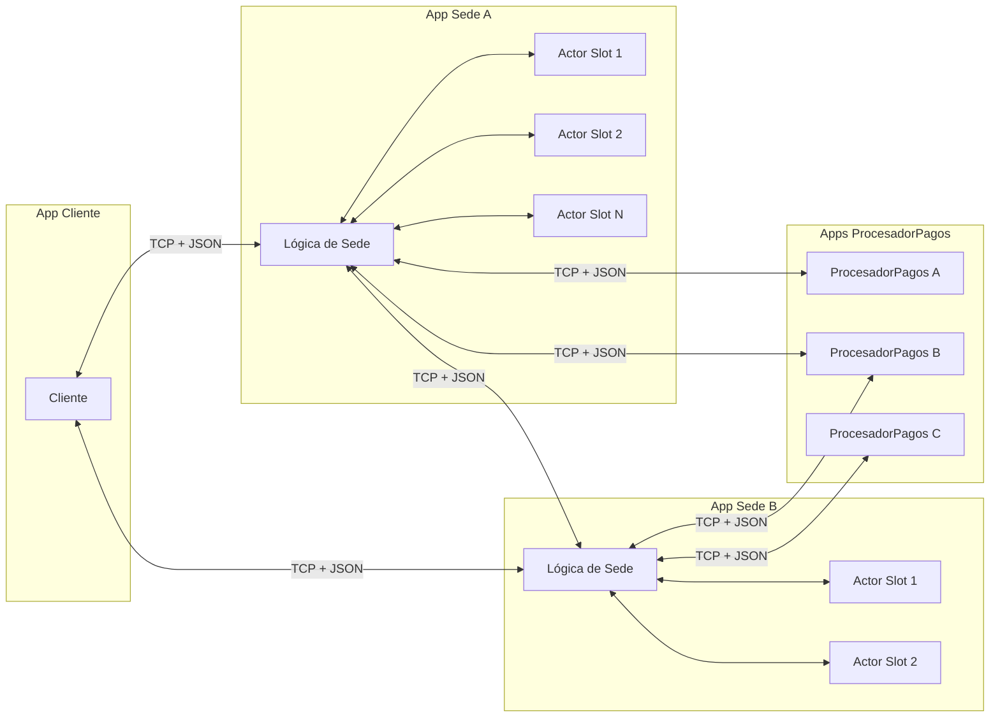

## Bici

`Bici` es una estructura de datos, no un actor. Representa a la bicicleta física y viaja como payload dentro de los mensajes del sistema. Su identificador único permite que las estaciones la reconozcan al momento de asegurarla o liberarla.

```rs
pub struct Bici {
    bici_id: String,
}
```
 
---

## Slot

`Slot` es el único componente del sistema modelado como actor interno de una Sede. No corre como aplicación independiente ni expone una conexión TCP propia. Su ciclo de vida está administrado por la App Sede que lo contiene.

Cada Sede tiene 20 slots, que al iniciar arrancan aleatoriamente en `Vacio` o `Disponible`. Al ser un actor, su estado es gestionado de forma concurrente y segura dentro del modelo de actores. La Sede se comunica con sus Slots mediante `Addr<Slot>`, porque ambos viven dentro del mismo proceso.

```rs
pub struct Slot {
    slot_id: u32,
    estado: EstadoSlot,
}
```

El Slot no conoce una `Addr<Sede>` ni se comunica directamente con otras aplicaciones. La coordinación de la operación completa queda en manos de la App Sede, que consulta o modifica el estado de sus Slots enviándoles mensajes locales.

### EstadoSlot

```rs
pub enum EstadoSlot {
    Vacio,
    Reservado { bici_id: String },
    Disponible { bici_id: String },
}
```

Los tres estados describen la relación del slot con la bicicleta que alberga. Un slot `Vacio` no tiene bicicleta y puede recibir una devolución. Un slot `Disponible` tiene una bicicleta lista para ser alquilada. El estado `Reservado` es transitorio y se activa durante la saga de alquiler: el slot tiene una bicicleta pero está siendo procesada para entregarse a un cliente. Guarda el `bici_id` para poder volver al estado `Disponible` en caso de que la saga deba hacer rollback.

### Mensajes que recibe

La Sede le habla al Slot con mensajes Actix individuales, cada uno con su propio tipo de respuesta.

```rs
struct Reservar;        // -> ResultadoReserva { Reservada(String), Rechazada }
struct Confirmar;       // -> bool
struct Cancelar;        // -> bool
struct AsegurarBici { bici_id: String }; // -> bool
struct ConsultarBici;   // -> String
struct ExportarEstado;  // -> EstadoSlotPersistido

pub enum ResultadoReserva {
    Reservada(String),
    Rechazada,
}
```

* **Reservar**: Lleva el slot de `Disponible` a `Reservado`. Devuelve `Reservada(bici_id)` si lo logra y `Rechazada` en caso contrario. La Sede lo envía con `send().await` porque necesita el resultado antes de seguir la saga.
* **Confirmar**: Transiciona el slot de `Reservado` a `Vacio` cuando la bici fue entregada al cliente. Devuelve `true` si el slot estaba reservado.
* **Cancelar**: Transiciona el slot de `Reservado` a `Disponible`, restaurando el `bici_id`. Es el rollback de la saga cuando un paso posterior falla.
* **AsegurarBici**: Transiciona el slot de `Vacio` a `Disponible` con la bici devuelta. Lo usa el flujo de devolución.
* **ConsultarBici**: Devuelve una descripción textual del slot para la CLI.
* **ExportarEstado**: Devuelve el `EstadoSlotPersistido` del slot, que la Sede usa para armar el snapshot.

## Cliente

El Cliente es una aplicación independiente que representa la app móvil del usuario. Se comunica con la Sede a la que está conectado mediante una conexión TCP y se opera por una CLI.

```rs
pub struct Cliente {
    cliente_id: u32,
    coords: (f64, f64),
    writer: Option<OwnedWriteHalf>,
    reader: Option<Lines<BufReader<OwnedReadHalf>>>,
    bici_activa: Option<BiciAlquilada>,
    dinero: f64,
    sedes_conocidas: Vec<SedeInfo>,
    estado: bool,
    sede_conectada: u32,
    sedes_posiciones: HashMap<u32, (f64, f64)>,
}

pub struct BiciAlquilada {
    bici_id: String,
    alquiler_id: String,
    cliente_id: String,
    sede_origen_id: u32,
    inicio_ts: u64,
    token_alquiler: String,
}
```

`writer` y `reader` son las mitades de la conexión TCP a la Sede actual. `dinero` es el saldo del cliente, que se descuenta al alquilar y al devolver. `sedes_conocidas` guarda la última información de sedes que devolvió un `PedirSedes`.

`estado` indica si el cliente está online u offline, y se puede alternar por CLI para simular caídas. `sede_conectada` es el id de la Sede a la que está conectado actualmente, 0 si no hay ninguna. `sedes_posiciones` guarda las coordenadas conocidas de cada Sede, para que el cliente pueda validar si está dentro de rango antes de intentar conectarse a una sede offline.

`bici_activa` es el comprobante del alquiler en curso. Además del `bici_id`, la `BiciAlquilada` guarda `alquiler_id`, `cliente_id`, `sede_origen_id`, `inicio_ts` y `token_alquiler`. Con esos datos cualquier Sede puede procesar la devolución: identificar la bici, validar el token, calcular el monto a partir de `inicio_ts` y avisar a la Sede origen, sin depender de un registro global de alquileres.

### Mensajes que envía

```rs
pub enum MsgClienteASede {
    Handshake(Handshake),                           // { coords: (f64, f64) }
    SolicitarBici(SolicitarBici),                   // { cliente_id: u32, coords: (f64, f64), dinero: f64 }
    AckComprobanteAlquiler(AckComprobanteAlquiler), // { alquiler_id: String }
    DevolverBici(DevolverBici),                     // { bici: BiciAlquilada, coords: (f64, f64), dinero: f64 }
    PreguntarBicis(PreguntarBicis),
    PedirSedes(PedirSedes),                         // { coords: (f64, f64) }
}
```

`SolicitarBici` y `DevolverBici` incluyen el `dinero` actual del cliente para que la Sede valide que tiene saldo suficiente.

#### Handshake

El cliente lo envía al conectarse por TCP a una Sede, antes de cualquier otro mensaje. La Sede responde con `RespuestaHandshake`:

```rs
pub enum RespuestaHandshake {
    Aceptado,
    Rechazado(String),
}
```

Si la Sede está offline y el cliente queda fuera de rango, responde `Rechazado` con el motivo y cierra la conexión. En caso contrario responde `Aceptado`.

#### DevolverBici

El cliente lo envía para devolver la bicicleta que tiene alquilada. Lo puede mandar a cualquier Sede con espacio, no necesariamente a la de origen. Incluye la `BiciAlquilada` para que la Sede destino identifique la bici, calcule el cobro y avise a la Sede origen que el alquiler se cerró.

#### PreguntarBicis

El cliente lo envía para ver el estado de los slots de la Sede a la que está conectado. La Sede responde con un texto que describe cada slot y cuántos están ocupados.

#### PedirSedes

El cliente lo envía para obtener información de las sedes cercanas: coordenadas, disponibilidad de slots y conectividad. La Sede responde con lo que conoce de sí misma y de las sedes vecinas en su `sedes_conocidas`.

No hay una Sede central que resuelva este pedido. Todas las Sedes son pares y cada una responde con su información local más la que recibió por heartbeats, así que la respuesta es eventualmente consistente. El campo `ultimo_update_ts` de cada `SedeInfo` indica qué tan reciente es cada dato.

### Mensajes que recibe

Las respuestas de la Sede al Cliente viajan en dos enums según el pedido. `PedirSedes` responde directamente un `Vec<SedeInfo>` y `PreguntarBicis` un `String`.

```rs
pub enum RespuestaSolicitarBici {
    ComprobanteAlquilerEmitido(BiciAlquilada, f64),
    AlquilerConfirmado(BiciAlquilada),
    AlquilerRechazado(String),
}

pub enum RespuestaDevolverBici {
    DevolucionOk(Bici, f64),
    DevolucionRechazada(String),
}
```

#### ComprobanteAlquilerEmitido

Respuesta intermedia de `SolicitarBici`. La Sede envía la `BiciAlquilada` firmada junto con el dinero restante del cliente, antes de liberar la bici. El Cliente lo guarda de forma temporal y responde `AckComprobanteAlquiler`. La Sede no confirma el slot hasta recibir ese ack.

#### AlquilerConfirmado

Respuesta final exitosa de `SolicitarBici`. El slot quedó confirmado y la bici asignada. El Cliente guarda la `BiciAlquilada` en `bici_activa` y la reenvía al devolverla.

#### AlquilerRechazado

Respuesta fallida de `SolicitarBici`, con el motivo: fuera de radio, saldo insuficiente, sin disponibilidad o pago rechazado.

#### DevolucionOk

Respuesta exitosa de `DevolverBici`. Incluye la `Bici` devuelta y el dinero restante del cliente.

#### DevolucionRechazada

Respuesta fallida de `DevolverBici`, con el motivo: fuera de radio, sin slots vacíos, token inválido, saldo insuficiente o cobro rechazado.
 
---

## Sede

La `Sede` es una aplicación independiente del sistema. Representa una estación física con 20 slots. Gestiona sus slots, procesa alquileres, recibe devoluciones, mantiene información parcial sobre sedes vecinas y puede operar tanto conectada como desconectada.

Cada Sede es responsable de persistir localmente la parte del estado que le corresponde. No existe un registro global centralizado de alquileres activos. En particular:

* La Sede origen guarda los alquileres que se iniciaron en ella y siguen activos.
* La Sede destino guarda las devoluciones que recibió.
* Si una bicicleta se devuelve en una Sede distinta a la de origen, la Sede destino notifica a la Sede origen para que cierre el alquiler.
* El `ProcesadorPagos` registra pagos, pero no conoce la lógica interna de los alquileres.

No existe una sede central ni elección de líder entre Sedes. Todas las Sedes tienen el mismo rol y se coordinan de forma directa mediante mensajes entre pares. La información de disponibilidad y conectividad se propaga por heartbeats, mientras que los alquileres y devoluciones se concilian entre la Sede origen y la Sede destino involucradas.

```rs
pub struct Sede {
    sede_id: u32,
    coords: (f64, f64),
    slots: Vec<Addr<Slot>>,
    token_secret: [u8; SECRET_LEN],
    pending_reservas: HashMap<String, (usize, BiciAlquilada)>,
    sedes_conocidas: Vec<SedeInfo>,
    sede_info: SedeInfo,
    procesador_pagos_addrs: Vec<String>,
    lider_cacheado: Arc<Mutex<Option<String>>>,
    estado_path: String,
    alquileres_activos: Vec<AlquilerActivo>,
    devoluciones_recibidas: Vec<DevolucionRecibida>,
    pagos_pendientes: Vec<PagoPendiente>,
    notificaciones_pendientes: Vec<NotificacionPendiente>,
    offline: Arc<Mutex<bool>>,
    estaba_offline: bool,
}
```

`slots` son las `Addr<Slot>` de los actores internos. `procesador_pagos_addrs` son las direcciones TCP de los nodos `ProcesadorPagos`, con los que la Sede habla por TCP en lugar de `Addr<T>`. `lider_cacheado` guarda el último líder de pagos que respondió. Si falla o contesta `NoSoyLider`, se invalida el cache y se prueban los demás nodos.

`token_secret` es el secreto compartido con el que se genera y valida el `token_alquiler`. `pending_reservas` mapea `alquiler_id → (slot, comprobante)` para las reservas en curso hasta que se confirman. `sede_info` es la `SedeInfo` propia que se propaga por heartbeat. `estado_path` es el archivo de snapshot.

`alquileres_activos` son los alquileres iniciados en esta Sede que siguen abiertos y `devoluciones_recibidas` son las devoluciones que recibió. `notificaciones_pendientes` guarda las devoluciones que no se pudieron avisar a la Sede origen y se reintentan al reconectar. `pagos_pendientes` guarda las operaciones de pago (`PreAutorizarPago`, `CobrarPago`, `ReembolsarPago`) que no se pudieron confirmar con el `ProcesadorPagos` y se reintentan al reconectar.

### Sedes pares y descubrimiento por heartbeats

Todas las Sedes son equivalentes: ninguna coordina ni centraliza a las demás. Cada Sede mantiene su propio estado local, su lista de `sedes_conocidas` y una vista eventualmente consistente de la disponibilidad del resto.

La comunicación entre Sedes se usa solo para los casos necesarios: propagar información de disponibilidad mediante `Heartbeat`, notificar devoluciones a la Sede origen y confirmar esas notificaciones con `AckDevolucion`.

Cada Sede sigue siendo responsable de persistir localmente los alquileres que originó y las devoluciones que recibió. Si una bicicleta se devuelve en una Sede distinta a la de origen, la Sede destino notifica directamente a la Sede origen para que esta cierre el alquiler activo correspondiente.

La caída de una Sede no altera el funcionamiento. Las otras Sedes continúan operando con su estado local y con la última información recibida por heartbeats. Cuando la Sede caída vuelve, retoma el envío de heartbeats y reintenta sus notificaciones pendientes.

### Conectividad

La conectividad se representa con el flag `offline: Arc<Mutex<bool>>`, que se puede alternar por CLI para simular caídas. Estando offline, la Sede sigue operando localmente con sus slots y encola las notificaciones que no puede entregar. El flag `estaba_offline` registra que estuvo caída, de modo que al reconectarse dispara el reintento de esas notificaciones.

### Estado local de alquileres y devoluciones

```rs
pub struct AlquilerActivo {
    alquiler_id: String,
    bici_id: String,
    cliente_id: String,
    sede_origen_id: u32,
    inicio_ts: u64,
    pago_preautorizacion_id: String,
    deadline_devolucion_ts: u64,
    estado: EstadoAlquiler,
    pago_multa_id: Option<String>,
    reembolso_multa_id: Option<String>,
}

pub enum EstadoAlquiler {
    Activo,
    Sospechoso,
    Cerrado,
    RoboConfirmado,
    RoboRevertido,
}

pub struct DevolucionRecibida {
    alquiler_id: String,
    bici_id: String,
    cliente_id: String,
    sede_origen_id: u32,
    sede_destino_id: u32,
    fin_ts: u64,
    monto: f64,
    pago_id: Option<String>,
    estado_pago: EstadoConciliacion,
    estado_notificacion_origen: EstadoConciliacion,
}

pub struct PagoPendiente {
    payment_request_id: String,
    alquiler_id: Option<String>,
    cliente_id: String,
    mensaje: MsgSedeAProcesadorPagos,
}

pub struct NotificacionPendiente {
    alquiler_id: String,
    bici_id: String,
    cliente_id: String,
    sede_origen_id: u32,
    sede_destino_id: u32,
    fin_ts: u64,
    monto: f64,
    pago_id: Option<String>,
    token_alquiler: String,
    intentos: u8,
}

pub enum EstadoConciliacion {
    Pendiente,
    Confirmado,
    Fallido,
}
```

`AlquilerActivo` es un alquiler iniciado en esta Sede que sigue abierto. Si la bici se devuelve en la misma Sede se cierra localmente, y si se devuelve en otra se cierra cuando llega `NotificarDevolucion`.

El `estado` distingue si el alquiler está `Activo`, `Cerrado`, `RoboConfirmado` o `RoboRevertido`. Al emitir el comprobante, la Sede programa una verificación: si pasados 60 segundos el alquiler sigue `Activo`, lo marca `RoboConfirmado` y captura el depósito como multa con un `CobrarPago`, guardando el resultado en `pago_multa_id`. Si más tarde la bici aparece por una devolución, el estado pasa a `RoboRevertido` y el depósito se reintegra, registrándose en `reembolso_multa_id`.

`DevolucionRecibida` es una bicicleta devuelta en esta Sede. Los campos `estado_pago` y `estado_notificacion_origen` siguen la conciliación del cobro y del aviso a la Sede origen.

`PagoPendiente` guarda el `mensaje` original a reenviar al `ProcesadorPagos` cuando un pago no se pudo confirmar, junto con los datos para reintentarlo.

`NotificacionPendiente` es un aviso de devolución hacia la Sede origen que todavía no se pudo entregar. Lleva el `token_alquiler` y un contador de `intentos`, y cubre el caso en que el destino recibe la bici pero no logra avisarle al origen en el momento.

### Persistencia y recuperación

La Sede persiste un snapshot completo de su estado en un archivo JSON (`estado_sede_<id>.json`). Tras cada cambio relevante —reservar, confirmar, cancelar o asegurar una bici, registrar un alquiler o una devolución, agregar un pendiente— vuelca el snapshot de forma atómica, escribiendo un `.tmp` y renombrando.

```rs
struct EstadoPersistenteSede {
    slots: Vec<EstadoSlotPersistido>,
    pending_reservas: Vec<(String, usize, BiciAlquilada)>,
    alquileres_activos: Vec<AlquilerActivo>,
    devoluciones_recibidas: Vec<DevolucionRecibida>,
    pagos_pendientes: Vec<PagoPendiente>,
    notificaciones_pendientes: Vec<NotificacionPendiente>,
}

pub enum EstadoSlotPersistido {
    Vacio,
    Reservado { bici_id: String },
    Disponible { bici_id: String },
}
```

Al reiniciar, la Sede carga el snapshot y rehidrata sus colecciones directamente. Los slots se reconstruyen desde `slots`, con una salvedad: un slot `Reservado` cuyo alquiler no aparece respaldado en `alquileres_activos` corresponde a una saga que se cortó antes de confirmarse, así que se compensa volviéndolo a `Disponible`.

Como cada Sede tiene 20 slots, persistir el estado completo ante cada cambio no es costoso y simplifica la recuperación: alcanza con leer el último snapshot, sin reconstruir nada evento por evento.

Los campos `slots_vacios` y `slots_disponibles` de `SedeInfo` se calculan a partir del estado real de los slots, no se guardan como fuente de verdad aparte.

### Operación Offline

El flag `offline` se puede activar por CLI para simular que una Sede pierde conectividad. Aun offline, la Sede sigue operando localmente: alquila sus propias bicicletas y recibe devoluciones en slots vacíos. Cuando recibe una devolución de un alquiler originado en otra Sede y no puede avisarle, encola el aviso en `notificaciones_pendientes` y lo persiste en el snapshot. Del mismo modo, si una operación de pago no se puede confirmar con el `ProcesadorPagos`, se encola en `pagos_pendientes`.

```rs
notificaciones_pendientes: Vec<NotificacionPendiente>,
pagos_pendientes: Vec<PagoPendiente>,
```

Al volver online, la Sede detecta la transición con `estaba_offline` y dispara dos flushes: reenvía cada `NotificacionPendiente` a su Sede origen y, cuando recibe el `AckDevolucion`, la marca como conciliada y la saca de la cola; y reintenta cada `PagoPendiente` contra el `ProcesadorPagos`, sacándolo de la cola si fue aceptado o rechazado de forma definitiva. Así el sistema converge por consistencia eventual: durante la partición las sedes tienen información parcial, y al reconectar reconcilian lo que quedó pendiente persistido localmente.

### Mensajes que envía

Al Cliente le responde con `RespuestaSolicitarBici` y `RespuestaDevolverBici` (sección Cliente), más un `Vec<SedeInfo>` para `PedirSedes` y un `String` para `PreguntarBicis`. A sus Slots les manda los mensajes individuales de la sección Slot. Al `ProcesadorPagos` y a otras Sedes les envía los enums siguientes.

```rs
pub enum MsgSedeAProcesadorPagos {
    PreAutorizarPago {
        payment_request_id: String,
        cliente_id: String,
        monto_seguridad: f64,
    },
    CobrarPago {
        payment_request_id: String,
        alquiler_id: String,
        cliente_id: String,
        monto_final: f64,
    },
    ReembolsarPago {
        payment_request_id: String,
        alquiler_id: String,
        cliente_id: String,
        pago_original_id: String,
        monto_reembolso: f64,
    },
}
```

```rs
pub enum MsgSedeHeartbeat {
    Heartbeat(Heartbeat), // { sede_id: u32, info: SedeInfo }
}

pub enum MsgSedeASede {
    NotificarDevolucion(NotificarDevolucion),
}

pub struct NotificarDevolucion {
    alquiler_id: String,
    bici_id: String,
    cliente_id: String,
    sede_origen_id: u32,
    sede_destino_id: u32,
    fin_ts: u64,
    monto: f64,
    pago_id: Option<String>,
    token_alquiler: String,
}
```

`NotificarDevolucion` se responde con `AckDevolucion { alquiler_id }`, que es su tipo de resultado.

#### Heartbeat

La Sede envía periódicamente un `Heartbeat` a las sedes que se encuentran dentro de un radio fijo definido por el sistema. El envío se realiza sin esperar una respuesta, ya que no requiere confirmación. El payload incluye la información actualizada de la propia Sede.

Las sedes receptoras actualizan su `sedes_conocidas` con los datos recibidos. Esta información es eventualmente consistente y no representa un registro global de alquileres.

Cuando un cliente solicita `PedirSedes`, la Sede responde con la información que conoce localmente en `sedes_conocidas`, incluyendo la propia.

Si una Sede deja de recibir heartbeats de otra durante cierto tiempo, puede marcarla como no conectada dentro de `sedes_conocidas`.

#### NotificarDevolucion y AckDevolucion

La Sede destino envía `NotificarDevolucion` a la Sede origen cuando una bicicleta se devuelve en una estación distinta a la que inició el alquiler. El destino ya validó el `token_alquiler` antes de aceptar la devolución, y reenvía ese mismo token dentro del mensaje.

Al recibir `NotificarDevolucion`, la Sede origen tiene tres casos:

* **Alquiler activo**: encuentra el `alquiler_id` en sus `alquileres_activos`, lo cierra removiéndolo y responde `AckDevolucion`.
* **Estaba como robo**: si lo tenía en `RoboConfirmado`, interpreta que la bici apareció tarde, lo pasa a `RoboRevertido`, persiste el snapshot y responde `AckDevolucion`.
* **Ya procesado**: si el alquiler ya estaba cerrado, robado o revertido, responde `AckDevolucion` por idempotencia.

Si la Sede destino no puede contactar a la Sede origen, encola una `NotificacionPendiente` y la reintenta al reconectar. Cuando origen y destino son la misma Sede, la notificación se resuelve localmente sin pasar por TCP.

#### PreAutorizarPago, CobrarPago y ReembolsarPago

La Sede los envía por TCP al líder de `ProcesadorPagos`. Ese líder lo elige Bully entre los nodos de pago y coordina un commit de dos fases para que la operación quede replicada.

`PreAutorizarPago` retiene el depósito durante la saga de alquiler, antes de confirmar el slot y liberar la bici. Si falla, la Sede cancela la reserva del slot y rechaza el alquiler.

`CobrarPago` cobra el monto de la devolución por el tiempo de uso, y también captura el depósito como multa cuando un alquiler se marca como robo. La Sede genera un `payment_request_id` único para que el pedido sea idempotente y pueda reintentarlo contra otro nodo con el mismo id.

`ReembolsarPago` reintegra el depósito retenido al cliente cuando devuelve la bici. Si el alquiler estaba marcado como robo, ese reintegro acompaña la reversión a `RoboRevertido`.

Los mensajes se envían esperando respuesta, ya que el resultado del pago determina cómo sigue el flujo.

### Mensajes que recibe

Los mensajes que la Sede recibe de los clientes son los definidos en `MsgClienteASede`. Los mensajes que recibe desde otras sedes son los definidos en `MsgSedeASede`. Además, la Sede recibe respuestas desde los nodos `ProcesadorPagos` para saber si una pre-autorización o un cobro fue aceptado o rechazado.

---

## ProcesadorPagos

El `ProcesadorPagos` es una aplicación independiente encargada de simular la lógica de pagos del sistema. No vive dentro de una Sede ni se comunica mediante `Addr<T>`, sino que corre como un proceso separado al que las Sedes acceden por red.

El sistema puede tener varios nodos `ProcesadorPagos`. Entre ellos ejecutan el algoritmo Bully para elegir un líder de pagos. Ese líder no decide la lógica de alquileres, pero sí coordina las operaciones de pago que llegan desde las Sedes.

Cuando una Sede necesita pre-autorizar, cobrar, cobrar una multa por robo o reembolsar una penalización, envía el pedido al líder de pagos conocido. Si ese líder no responde, la Sede puede contactar a otro nodo de pagos. Ante la caída del líder, los nodos `ProcesadorPagos` ejecutan Bully y el nuevo líder se anuncia al resto.

El `Cliente` no se comunica directamente con el `ProcesadorPagos`. La Sede es quien tramita el pago: recibe la solicitud del Cliente, calcula cuándo corresponde pre-autorizar, cobrar o reembolsar, y luego delega esa operación en el líder de pagos.

El `ProcesadorPagos` no conoce la lógica de alquileres. No decide si un alquiler está activo, cerrado, robado o revertido. Únicamente recibe datos de una operación de pago, la persiste localmente y responde si fue aceptada o rechazada. El `alquiler_id`, si aparece en el mensaje, se trata como un identificador externo opaco usado para trazabilidad.

```rs
struct ProcesadorPagos {
    procesador_id: u32,
    ip: IpAddr,
    public_listener: TcpListener,
    bus_2pc: TcpListener,
    socket: UdpSocket,
    peers: Vec<SocketAddr>,
    liveness: Mutex<HashMap<SocketAddr, InfoNodo>>,
    rol_actual: Mutex<RolActual>,
    recibio_ok: Mutex<bool>,
    tiempos: Tiempos,
    pagos_procesados: Mutex<Vec<PagoProcesado>>,
    transacciones_en_curso: Mutex<Vec<TransaccionPago2PC>>,
    preparados_replica: Mutex<HashMap<String, MsgSedeAProcesadorPagos>>,
    rechazar_si_monto_supera: Option<f64>,
    estado_path: String,
}

enum RolActual {
    Lider,
    Candidato,
    Replica { lider_id: u32 },
}
```

El nodo usa tres canales: `public_listener` (TCP) recibe los pedidos de pago de las Sedes, `bus_2pc` (TCP) transporta el commit de dos fases entre procesadores y `socket` (UDP) lleva los mensajes de Bully (heartbeats y elección). `peers` son los demás nodos conocidos y `liveness` registra cuáles están vivos según sus heartbeats.

`rol_actual` arranca según la config y muta a `Lider`, `Candidato` o `Replica { lider_id }` a medida que Bully resuelve la elección. `recibio_ok` recuerda si el nodo recibió un `Ok` durante una elección en curso y `tiempos` agrupa los timeouts configurables:

```rs
pub struct Tiempos {
    pub heartbeat: Duration,
    pub monitor: Duration,
    pub liveness_timeout: Duration,
    pub espera_ok: Duration,
    pub espera_coordinador: Duration,
}
```

`heartbeat` es el intervalo entre heartbeats propios y `liveness_timeout` cuánto se espera el heartbeat de un peer antes de considerarlo caído, siempre mayor que `heartbeat` para evitar falsos positivos. `monitor` es la frecuencia con la que el nodo chequea la liveness de sus peers. `espera_ok` y `espera_coordinador` son los timeouts de una elección Bully: cuánto se espera un `Ok` tras una `Eleccion` y cuánto se espera el `Coordinador` del nuevo líder.

`pagos_procesados` es el historial local de operaciones que el servicio aceptó o rechazó, sin reemplazar el estado de las Sedes. `transacciones_en_curso` guarda los 2PC en vuelo para reconstruir si una operación quedó preparada, confirmada o abortada. `preparados_replica` recuerda las operaciones que una réplica preparó y espera resolver con un commit o abort posterior. `rechazar_si_monto_supera` es un umbral opcional para simular rechazos y `estado_path` apunta al snapshot durable.

### Estado de soporte

```rs
pub struct PagoProcesado {
    payment_request_id: String,
    pago_id: String,
    alquiler_id: Option<String>,
    cliente_id: String,
    monto: f64,
    tipo: TipoOperacionPago,
    estado: EstadoPago,
}

pub enum TipoOperacionPago {
    PreAutorizacion,
    CobroFinal,
    MultaRobo,
    ReembolsoPenalizacion,
}

pub enum EstadoPago {
    PreAutorizado,
    Aceptado,
    Reembolsado,
    Rechazado,
}

pub struct TransaccionPago2PC {
    payment_request_id: String,
    operacion: PagoProcesado,
    participantes: Vec<u32>,
    votos_commit: Vec<u32>,
    votos_abort: Vec<u32>,
    estado: EstadoTransaccionPago,
}

pub enum EstadoTransaccionPago {
    Preparando,
    Preparada,
    Commit,
    Abort,
}
```

Para evitar cobros duplicados ante reintentos, cada operación de pago se identifica con un `payment_request_id` único generado por la Sede. Si el líder de pagos recibe nuevamente un pedido con el mismo `payment_request_id`, no vuelve a ejecutar el cobro: devuelve la misma respuesta que ya fue persistida.

`EstadoPago::PreAutorizado` indica que el cliente pasó la validación previa necesaria para poder retirar una bicicleta. `EstadoPago::Aceptado` indica que el cobro final o la multa fueron procesados correctamente. `EstadoPago::Reembolsado` indica que una penalización cobrada previamente fue devuelta. `EstadoPago::Rechazado` indica que la operación fue rechazada por la simulación del procesador.

### Mensajes que recibe desde Sede

```rs
pub enum MsgSedeAProcesadorPagos {
    PreAutorizarPago {
        payment_request_id: String,
        cliente_id: String,
        monto_seguridad: f64,
    },
    CobrarPago {
        payment_request_id: String,
        alquiler_id: String,
        cliente_id: String,
        monto_final: f64,
    },
    ReembolsarPago {
        payment_request_id: String,
        alquiler_id: String,
        cliente_id: String,
        pago_original_id: String,
        monto_reembolso: f64,
    },
}
```

`PreAutorizarPago`: Simula la pre-autorización de un monto de seguridad antes de liberar una bicicleta. Si la operación es aceptada, responde con `PagoPreAutorizado`. Si es rechazada, responde con `PagoRechazado`.

`CobrarPago`: Simula el cobro final de una devolución o el cobro de una multa por robo. Recibe el `alquiler_id`, el `cliente_id` y el monto calculado por la Sede. Si la operación es aceptada, responde con `PagoAceptado { pago_id }`. Si es rechazada, responde con `PagoRechazado`.

`ReembolsarPago`: Simula la devolución de una penalización cobrada previamente. Se usa cuando la Sede origen había marcado una bicicleta como robada, pero luego recibe una notificación tardía válida de la Sede destino. Si la operación es aceptada, responde con `PagoReembolsado { pago_id }`.

### Mensajes que envía a Sede

```rs
pub enum MsgProcesadorPagosASede {
    PagoPreAutorizado {
        payment_request_id: String,
        pago_id: String,
    },
    PagoAceptado {
        payment_request_id: String,
        pago_id: String,
    },
    PagoReembolsado {
        payment_request_id: String,
        pago_id: String,
    },
    PagoRechazado {
        payment_request_id: String,
        motivo: String,
    },
    NoSoyLider {
        lider_addr: Option<SocketAddr>,
    },
}
```

`PagoPreAutorizado`: Indica que el cliente puede continuar con el proceso de alquiler.

`PagoAceptado`: Indica que el cobro final o la captura del depósito por robo fueron realizados correctamente. Incluye un `pago_id` para que la Sede asocie el pago con la devolución o con el robo confirmado.

`PagoReembolsado`: Indica que se devolvió el depósito retenido previamente.

`PagoRechazado`: Indica que la operación fue rechazada. Durante el alquiler dispara el rollback del slot reservado. Durante la devolución, la Sede responde con `DevolucionRechazada`.

`NoSoyLider`: La responde un nodo que recibió un pedido sin ser el líder. Incluye, si lo conoce, la dirección del líder actual para que la Sede redirija el pedido.

### Mensajes entre procesadores

Los procesadores usan dos protocolos sobre canales distintos. Bully viaja por UDP y elige el líder. El commit de dos fases viaja por un bus TCP aparte y replica cada decisión de pago.

```rs
// Bully (UDP)
pub enum MsgProcesador {
    Heartbeat { procesador_id: u32, es_lider: bool },
    HeartbeatAck { procesador_id: u32 },
    Eleccion { procesador_id: u32 },
    Ok { procesador_id: u32 },
    Coordinador { lider_id: u32 },
}
```

`Heartbeat` y `HeartbeatAck` mantienen la detección de vivos entre nodos. `Eleccion`, `Ok` y `Coordinador` son el núcleo de Bully: un nodo que detecta al líder caído arranca una elección, los nodos de mayor id responden `Ok`, y el mayor que sigue vivo se anuncia con `Coordinador`.

```rs
// Commit de dos fases (TCP)
pub enum MsgProcesadorAProcesador {
    PrepararPago { payment_request_id: String, pago: MsgSedeAProcesadorPagos },
    VotoPago { payment_request_id: String, votante_id: u32, voto: Voto2PC },
    CommitPago { payment_request_id: String },
    AbortPago { payment_request_id: String },
    AckDecisionPago { payment_request_id: String, votante_id: u32 },
    ConsultarPago { payment_request_id: String },
    RespuestaConsultaPago { payment_request_id: String, pago: Option<PagoProcesado> },
}

pub enum Voto2PC {
    Commit,
    Abort,
}
```

`PrepararPago` lleva la operación original de la Sede y pide a cada réplica que la deje preparada. Cada una responde con `VotoPago` identificándose por `votante_id`. Si todos votan `Commit`, el líder manda `CommitPago`, en caso contrario manda `AbortPago`, y cada réplica confirma con `AckDecisionPago`.

`ConsultarPago` y `RespuestaConsultaPago` resuelven reintentos idempotentes. Un nodo que recibe un pedido repetido consulta el estado de esa operación y devuelve la decisión ya tomada.

### Protocolo de comunicación

La comunicación entre una Sede y el servicio de pagos se realiza por TCP mediante mensajes serializados. La Sede intenta enviar el pedido al líder de pagos conocido. Si el líder no responde, contacta a otro procesador. Ese procesador puede informar el líder actual o iniciar una nueva elección Bully si detecta que el coordinador cayó.

Cuando el líder recibe una operación nueva, primero verifica si ya existe un `PagoProcesado` con ese `payment_request_id`. Si existe, devuelve la respuesta persistida previamente y no vuelve a ejecutar la operación.

Si no existe, el líder inicia 2PC contra los demás procesadores. En la fase de prepare, cada participante valida si puede aceptar la operación y la deja registrada como preparada. En la fase de commit, si todos votaron afirmativamente, el líder confirma la operación y todos la persisten como definitiva. Si hay timeout o algún voto negativo, el líder envía abort y la Sede recibe `PagoRechazado` o deja la operación pendiente para reintentar.

Este protocolo permite tolerar timeouts, respuestas perdidas, reintentos contra distintos nodos y caída del líder de pagos sin duplicar cobros ni reembolsos.

---

## Saga de Alquiler

El proceso de alquiler involucra múltiples pasos que deben ejecutarse de forma coordinada. Si alguno falla antes de liberar la bicicleta, los pasos anteriores deben compensarse para no dejar el sistema en un estado inconsistente. Este patrón se conoce como Saga.

En este sistema no se intenta garantizar atomicidad estricta entre la liberación física de la bicicleta y la persistencia del alquiler activo. En cambio, se utiliza una estrategia de consistencia eventual basada en un comprobante firmado del alquiler.

Antes de liberar la bicicleta, la Sede origen genera una `BiciAlquilada` con un `token_alquiler`. El token es un `PayloadToken` con los datos del alquiler, cifrado y autenticado con ChaCha20-Poly1305 usando un secreto compartido entre todas las Sedes, derivado de la variable de entorno `TOKEN_SECRET`.

```rs
pub struct PayloadToken {
    bici_id: String,
    alquiler_id: String,
    cliente_id: String,
    sede_origen_id: u32,
    inicio_ts: u64,
}

token_alquiler = cifrar_autenticado_chacha20poly1305(PayloadToken, secreto_compartido)
```

Cualquier Sede puede descifrar el token con el secreto compartido y verificar que los datos los emitió una Sede válida y que el Cliente no los alteró. El token viaja dentro de la `BiciAlquilada` y acompaña a la bici durante todo el alquiler.

Si la validación falla, `validar_token` devuelve un `TokenError` con el motivo:

```rs
pub enum TokenError {
    Base64Invalido,
    BloqueDemasiadoCorto,
    AutenticacionFallida,
    PayloadInvalido,
    SerializacionFallida,
    CifradoFallido,
}
```

La Sede destino trata cualquier `TokenError` igual: rechaza la devolución con `DevolucionRechazada`, incluyendo el error en el motivo.

```rs
pub struct BiciAlquilada {
    bici_id: String,
    alquiler_id: String,
    cliente_id: String,
    sede_origen_id: u32,
    inicio_ts: u64,
    token_alquiler: String,
}
```

Los pasos y sus compensaciones son:

| Paso | Acción                                                                      | Compensación si falla el siguiente        |
| ---- | --------------------------------------------------------------------------- | ----------------------------------------- |
| 1    | Reservar Slot (`send().await`): `Disponible` → `Reservado`                  | Cancelar Slot: `Reservado` → `Disponible` |
| 2    | Pre-autorizar pago en `ProcesadorPagos` por TCP                             | Cancelar Slot: `Reservado` → `Disponible` |
| 3    | Generar `alquiler_id`, `inicio_ts` y `token_alquiler`                       | Cancelar Slot: `Reservado` → `Disponible` |
| 4    | Enviar `ComprobanteAlquilerEmitido` al Cliente                              | Cancelar Slot: `Reservado` → `Disponible` |
| 5    | Recibir `AckComprobanteAlquiler` del Cliente                                | Cancelar Slot: `Reservado` → `Disponible` |
| 6    | Confirmar Slot (`send().await`): `Reservado` → `Vacio`                      | —                                         |
| 7    | Registrar el `AlquilerActivo` en la Sede origen y persistir el snapshot     | —                                         |

Si el paso 1 falla, porque no hay slots en estado `Disponible`, se responde `AlquilerRechazado` directamente. Si el paso 2 falla, porque el pago fue rechazado o porque ningún nodo de pagos pudo pre-autorizar la operación, se envía `Cancelar` al Slot para volver al estado `Disponible`.

La parte importante de esta saga es que el Cliente recibe el comprobante firmado antes de que se confirme el slot. Con esa `BiciAlquilada` válida en mano, puede devolver la bici en cualquier Sede.

La Sede destino valida el token localmente con el secreto compartido. Si el token es válido, acepta la devolución, la registra localmente y luego concilia con la Sede origen. En el camino normal la Sede origen también guarda el `AlquilerActivo` en su snapshot, de modo que conoce el alquiler cuando llega la conciliación.

Los pasos 1, 2, 5 y 6 utilizan comunicación esperando respuesta porque la Sede necesita saber el resultado antes de avanzar. El envío del comprobante al Cliente también requiere confirmación, ya que no se libera la bicicleta hasta que el Cliente haya recibido la `BiciAlquilada` firmada.

---

## Devolución de Bicicleta

El proceso de devolución puede ocurrir en la misma Sede donde se inició el alquiler o en una Sede distinta. En ambos casos, la Sede que recibe la bicicleta se denomina Sede destino.

El flujo general es:

1. El Cliente envía `DevolverBici { bici, coords, dinero }` a la Sede destino.
2. La Sede destino verifica que el Cliente esté dentro del radio.
3. Valida el `token_alquiler`. Si es inválido, responde `DevolucionRechazada`.
4. Calcula el monto por el tiempo de uso a partir de `inicio_ts`. Si supera el saldo del Cliente, responde `DevolucionRechazada`.
5. Cobra el monto con `CobrarPago` al líder de pagos. Si lo rechazan, responde `DevolucionRechazada`.
6. Asegura la bici en un Slot `Vacio`. Si no hay ninguno, responde `DevolucionRechazada`.
7. Registra la `DevolucionRecibida` y, si el alquiler no era un robo local, lo remueve de `alquileres_activos`.
8. Reintegra el depósito con `ReembolsarPago`. Si el alquiler estaba marcado como robo, lo pasa a `RoboRevertido`.
9. Persiste el snapshot.
10. Avisa a la Sede origen con `NotificarDevolucion`, que incluye el `token_alquiler`. Si origen y destino son la misma Sede, lo resuelve localmente.
11. La Sede origen cierra el `AlquilerActivo` y responde `AckDevolucion`.
12. La Sede destino responde `DevolucionOk` con la `Bici` y el saldo actualizado.

Si la Sede origen no está disponible, la Sede destino encola una `NotificacionPendiente` y la reintenta al reconectar. Cuando recibe el `AckDevolucion`, marca la devolución como conciliada. Si ese aviso llega tarde y la Sede origen ya había marcado el alquiler como `RoboConfirmado`, lo pasa a `RoboRevertido`.

---

## Consistencia eventual entre sedes

El sistema no mantiene un registro global centralizado de alquileres activos. En su lugar, cada Sede persiste localmente la parte del estado que le corresponde.

En el camino normal, cuando una bicicleta se alquila en una Sede, esa Sede guarda un `AlquilerActivo` en su estado local y lo persiste en su snapshot. Antes de confirmar el slot emite la `BiciAlquilada` con `token_alquiler`, así el Cliente tiene un comprobante válido aunque después haya una caída.

Cuando la bicicleta se devuelve, hay dos casos:

* Si se devuelve en la misma Sede que originó el alquiler, esa Sede lo cierra localmente.
* Si se devuelve en otra Sede, la Sede destino procesa la devolución, cobra y luego avisa a la Sede origen con `NotificarDevolucion`.

La Sede origen es quien marca como cerrado el alquiler. La Sede destino conserva la `NotificacionPendiente` hasta recibir `AckDevolucion`.

La Sede origen no hace un pull activo ante un alquiler vencido. Al emitir el comprobante programa una verificación a los 60 segundos: si el alquiler sigue `Activo`, lo marca `RoboConfirmado` y captura el depósito como multa con un `CobrarPago`. Si después llega una `NotificarDevolucion`, interpreta que la bici apareció tarde y pasa el alquiler a `RoboRevertido`.

### Casos borde

Si la Sede destino recibe una bicicleta y la Sede origen está caída, conserva la `NotificacionPendiente` en su snapshot y la reintenta al reconectar. Cuando finalmente recibe el `AckDevolucion`, marca la devolución como conciliada.

Si la respuesta del `ProcesadorPagos` se pierde, la Sede reintenta el pedido con el mismo `payment_request_id`. Si el pago ya había sido procesado, el servicio devuelve la respuesta ya persistida sin ejecutar un nuevo cobro o reembolso.

Si una Sede cae, las demás continúan operando con su estado local y con la última información en `sedes_conocidas`, sin elección entre Sedes. Cuando la Sede caída vuelve, retoma los heartbeats y procesa sus notificaciones pendientes.

Si el líder de `ProcesadorPagos` cae, los procesadores ejecutan Bully para elegir uno nuevo. Las operaciones de pago se resuelven con 2PC para que un cobro o un reembolso no quede confirmado en un nodo y perdido en otro.

---

## Tipos de Soporte

Esta sección agrupa estructuras de datos que no representan procesos ni actores propios, pero que son compartidas entre varias entidades del sistema o viajan como payload dentro de los mensajes.

Los tipos internos propios de la Sede, como `AlquilerActivo`, `DevolucionRecibida`, `PagoPendiente` y `NotificacionPendiente`, se describen dentro de la sección `Sede`, ya que forman parte de su estado local.

### BiciAlquilada

Representa la información mínima que el Cliente conserva mientras tiene una bicicleta alquilada. No representa un historial completo del alquiler, sino el comprobante necesario para que cualquier Sede pueda procesar la devolución.

```rs
pub struct BiciAlquilada {
    bici_id: String,
    alquiler_id: String,
    cliente_id: String,
    sede_origen_id: u32,
    inicio_ts: u64,
    token_alquiler: String,
}
```

El campo `bici_id` identifica la bicicleta física. El campo `alquiler_id` identifica el alquiler activo. El campo `cliente_id` permite asociar el cobro con el usuario correspondiente. El campo `sede_origen_id` indica qué Sede debe ser notificada cuando la bicicleta sea devuelta. El campo `inicio_ts` permite que la Sede destino calcule el monto proporcional al tiempo de uso sin depender de un registro global centralizado.

El campo `token_alquiler` es el token cifrado y autenticado que genera la Sede origen con el secreto compartido. Permite que cualquier Sede valide que los datos del alquiler los emitió una Sede válida y que el Cliente no los inventó ni modificó.

### SedeInfo

```rs
pub struct SedeInfo {
    sede_id: u32,
    coords: (f64, f64),
    public_addr: String,
    private_addr: String,
    slots_vacios: u8,
    slots_disponibles: u8,
    conectada: bool,
    ultimo_update_ts: u64,
}
```

`public_addr` es la dirección TCP donde la Sede atiende a los clientes y `private_addr` la que usa para la comunicación entre sedes. Los campos `slots_vacios` y `slots_disponibles` indican cuántos slots pueden recibir devoluciones y cuántos tienen una bici lista para alquilar.

Ambos valores se calculan a partir del último estado conocido de los slots de la Sede, no se toman como fuente de verdad independiente.

El campo `ultimo_update_ts` permite a clientes y sedes saber qué tan reciente es la información sobre una Sede.

El campo `conectada` refleja si la Sede estaba accesible al momento del último heartbeat recibido, permitiendo al Cliente mostrar este estado en la aplicación.

---

## Diagramas de Secuencia

A continuación se presentan los casos de uso principales del sistema, incluyendo los flujos exitosos, los rechazos esperados y los casos borde más relevantes.
 
---

### 1. Alquiler exitoso

El cliente se encuentra dentro del radio permitido, hay un slot libre y el pago es autorizado. La Sede genera y entrega el comprobante firmado antes de liberar físicamente la bicicleta.

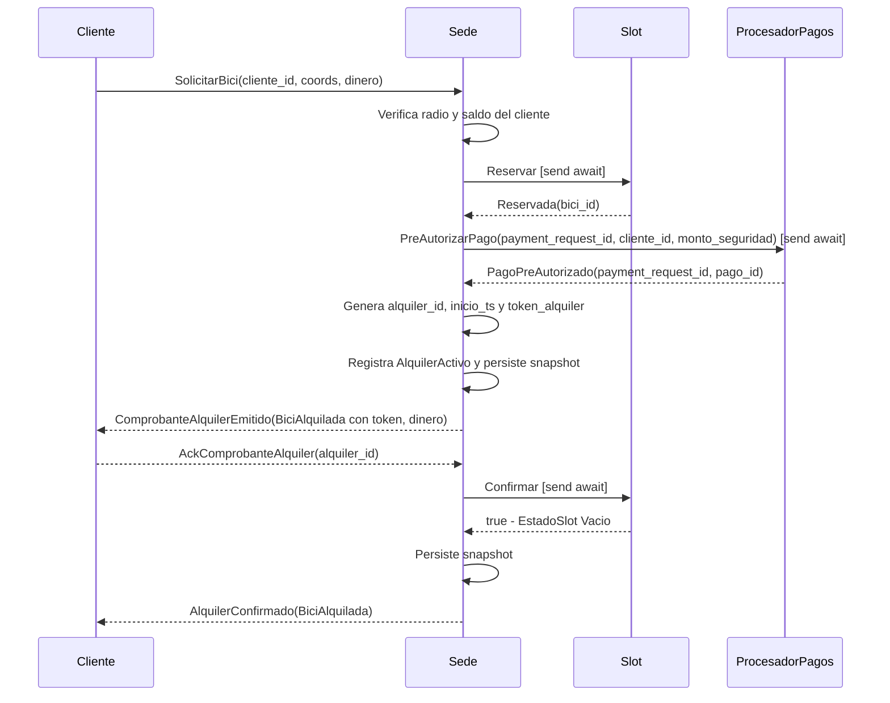

---

### 2. Alquiler rechazado — cliente fuera del radio

El cliente intenta alquilar una bici pero sus coordenadas están fuera del rango permitido por la sede. La Sede rechaza sin llegar a consultar los slots.

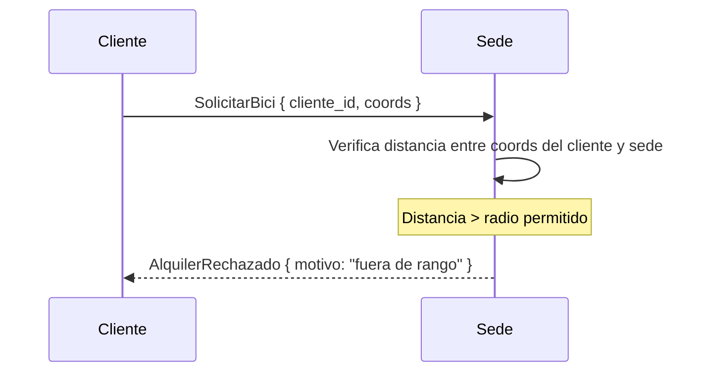

---

### 3. Alquiler rechazado — sede sin disponibilidad

El cliente está dentro del radio pero la sede no tiene ningún slot en estado `Disponible`. La Sede rechaza antes de iniciar la saga.

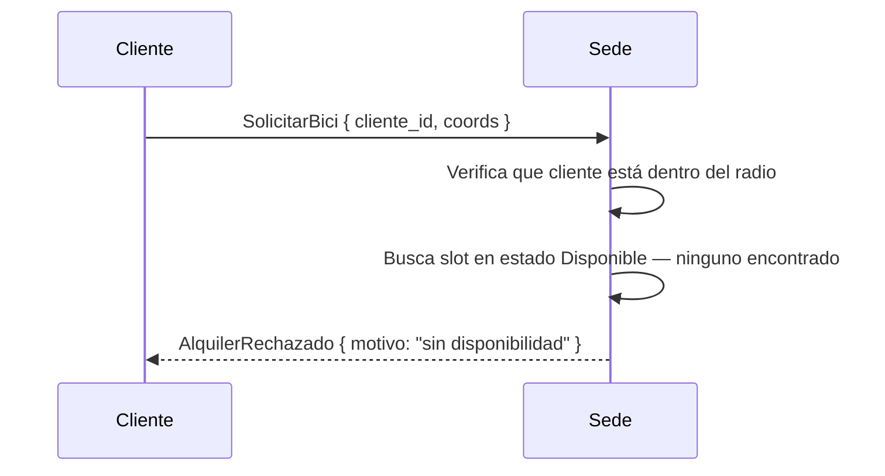

---

### 4. Devolución rechazada — sede sin slots vacíos

El cliente intenta devolver la bicicleta pero la sede no tiene ningún slot en estado `Vacio` para recibirla. El cliente debe buscar otra sede con lugar disponible.

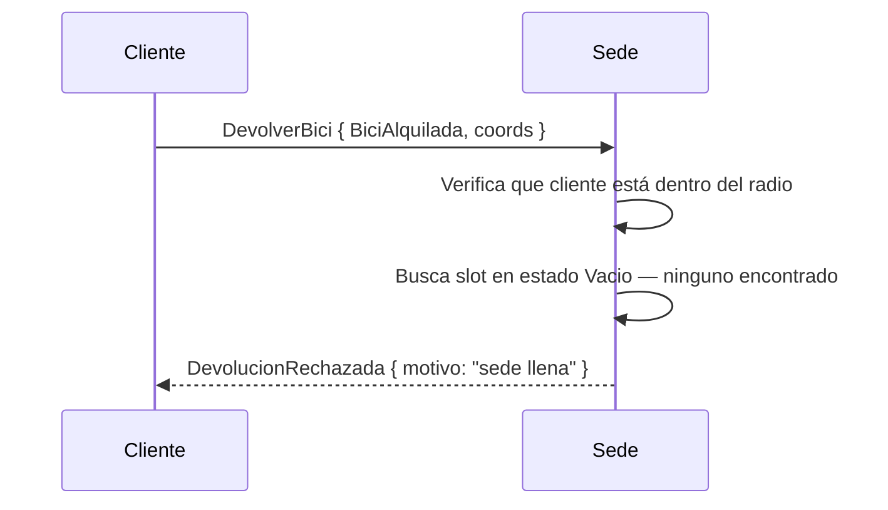

---

### 5. Saga con rollback — pago rechazado

El slot es reservado exitosamente pero la pre-autorización del pago falla. La Sede ejecuta la compensación correspondiente: cancela la reserva del slot para dejarlo disponible nuevamente.

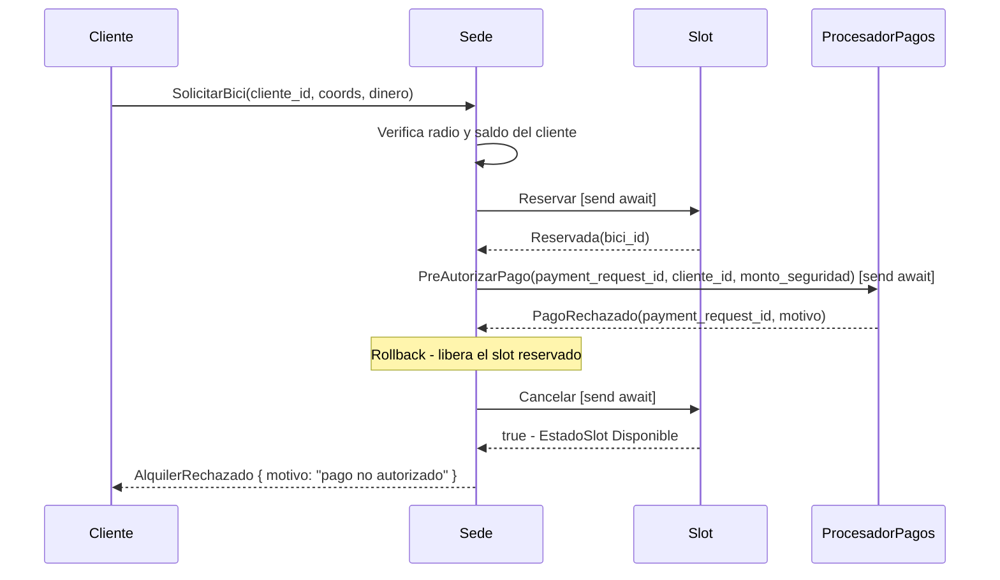

---

### 6. Dos clientes compiten por el último slot disponible

Este caso ilustra cómo el modelo de actores previene condiciones de carrera. La Sede procesa los mensajes de a uno, por lo que el segundo cliente recibe rechazo sin necesidad de locks explícitos.

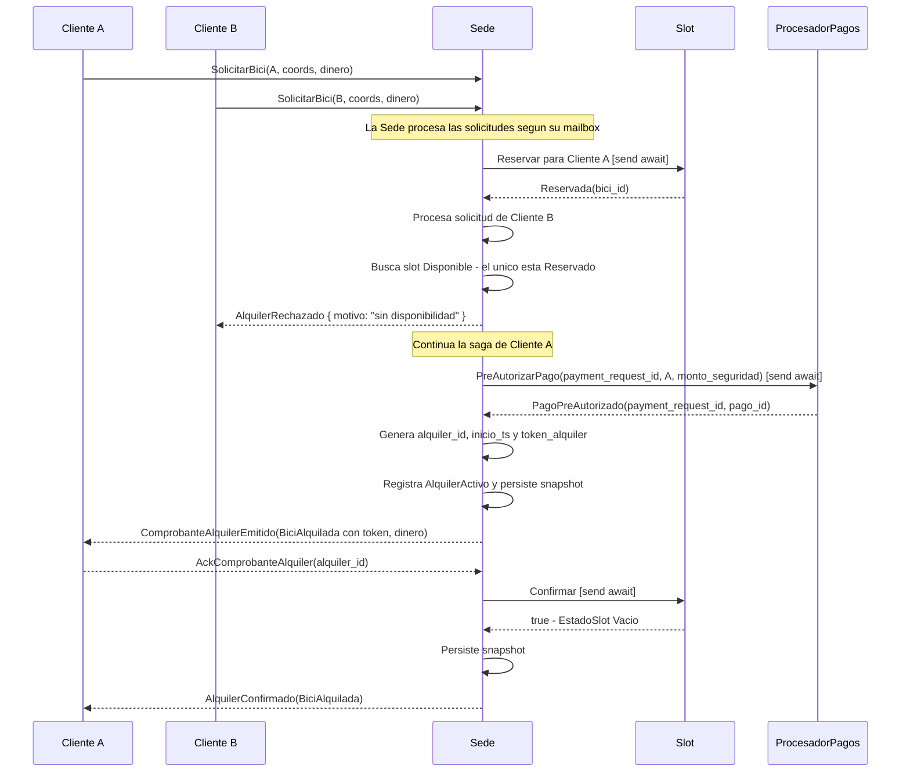

---

### 7. Devolución con sede desconectada

La sede perdió conectividad con el resto del sistema pero sigue operando localmente. Acepta la devolución si el `token_alquiler` es válido, asegura la bicicleta y deja pendientes las conciliaciones que no pueda completar en el momento.

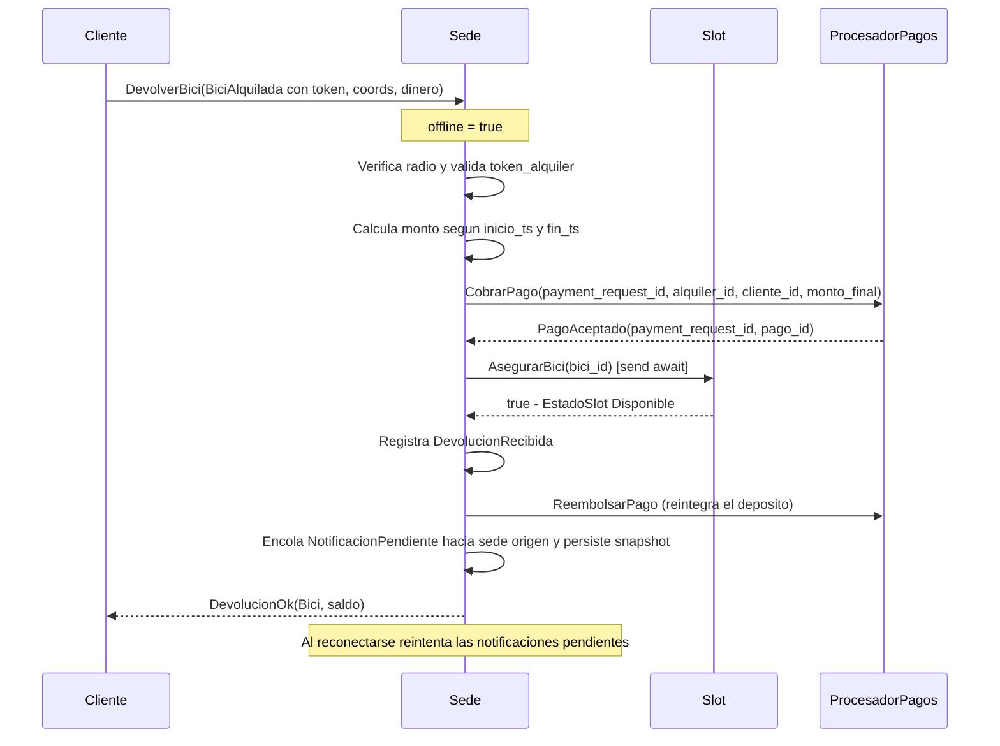

---

### 8. Cliente pide sedes cercanas

El cliente conectado a una Sede le pide la información de las sedes cercanas. La Sede responde con lo que conoce de sí misma y de sus vecinas, y el cliente la guarda en `sedes_conocidas` y la muestra ordenada por distancia.

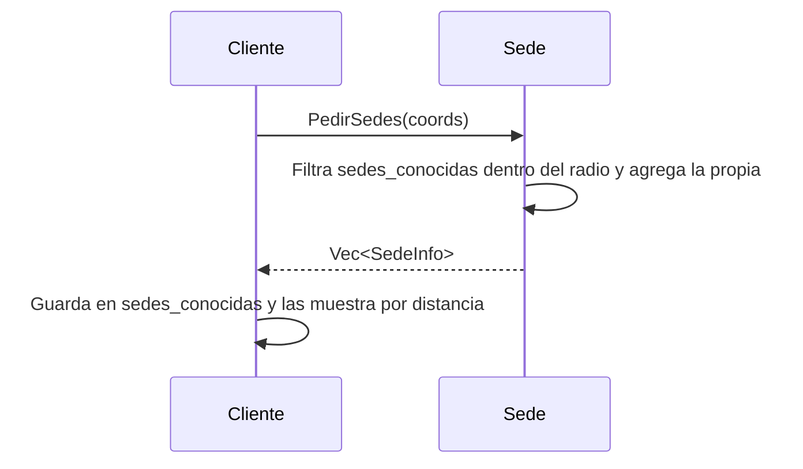

---

### 9. Devolución en sede distinta — pago y notificación exitosos

El cliente devuelve una bicicleta en una sede distinta a la que originó el alquiler. La Sede destino valida el comprobante firmado, asegura la bicicleta, cobra el monto correspondiente y notifica a la Sede origen para que cierre el alquiler activo.

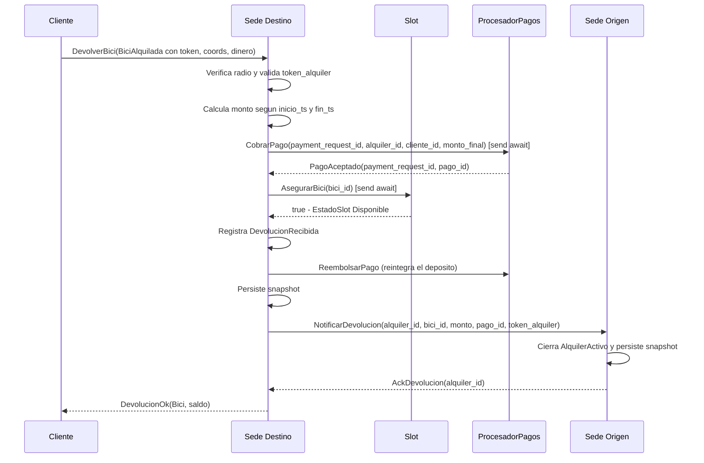

---

### 10. Devolución en sede distinta — sede origen no disponible

La Sede destino puede recibir la bicicleta aunque la Sede origen no esté disponible en ese momento. Para aceptar la devolución, primero valida el `token_alquiler`. Luego persiste la devolución y deja pendiente la notificación para reintentar más adelante.

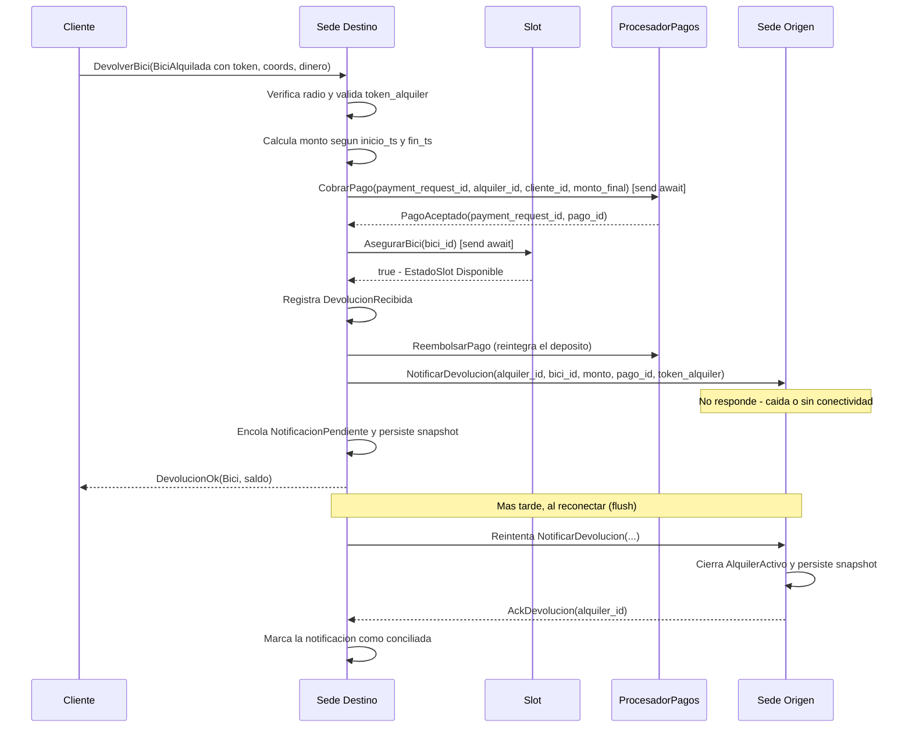

---

### 11. Sede origen no recibe la notificación a tiempo — robo confirmado

La Sede origen tiene un alquiler que sigue `Activo` pasados 60 segundos del comprobante. No consulta al resto de las sedes: marca el alquiler como `RoboConfirmado` y captura el depósito retenido como multa.

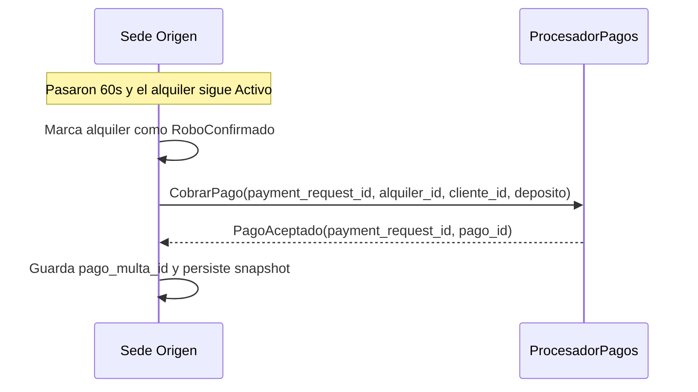

---

### 12. Notificación tardía — la bici no fue robada

La Sede destino recibió la bicicleta y ya reintegró el depósito al cliente, pero no había logrado avisarle a la Sede origen, que entretanto marcó el alquiler como robo. Cuando llega la notificación, la Sede origen entiende que la bici apareció y revierte el robo.

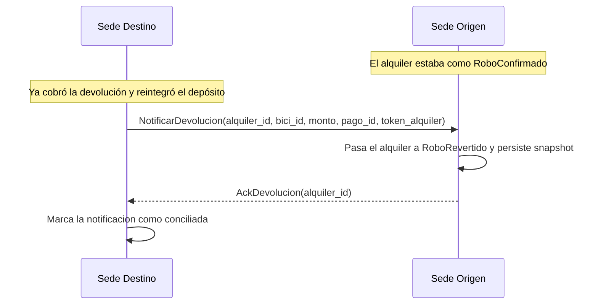

---

### 13. Devolución cuando la Sede origen perdió el registro del alquiler

El comprobante firmado permite devolver la bici aunque la Sede origen ya no tenga el alquiler en su estado, por ejemplo tras una caída. El destino valida el token y acepta, y el origen responde el ack aunque no encuentre el alquiler.

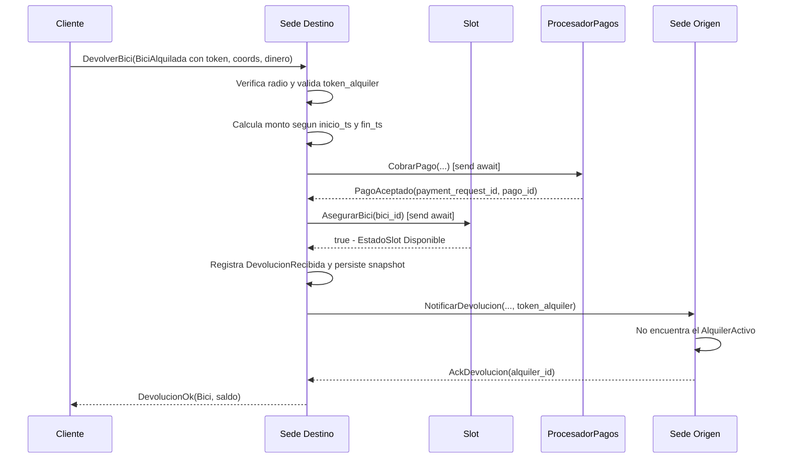