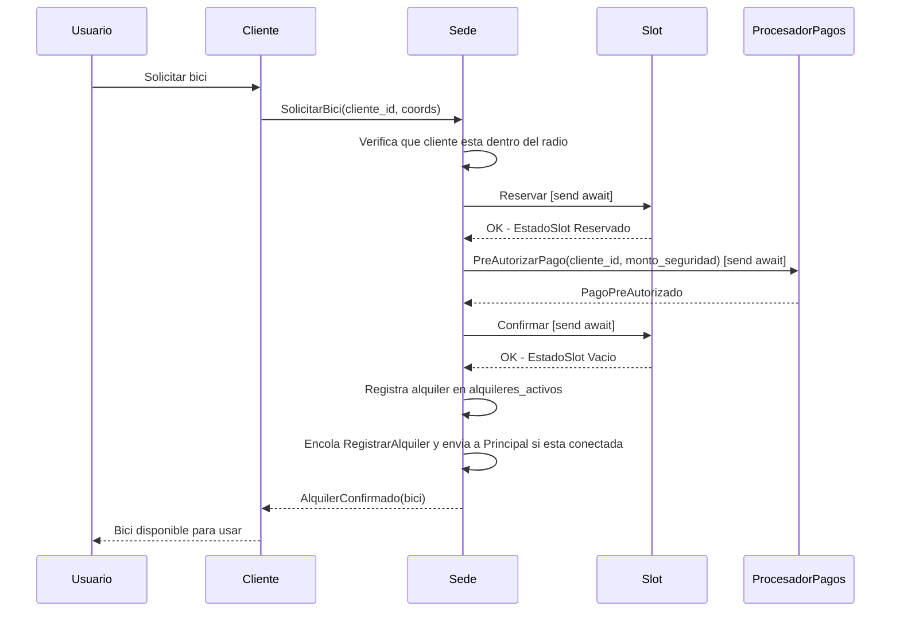
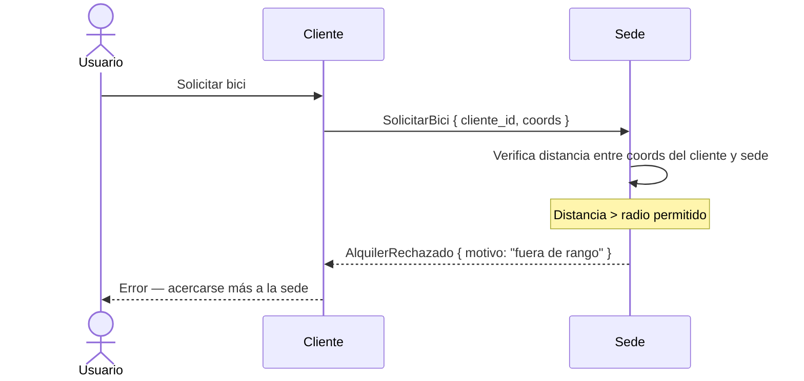
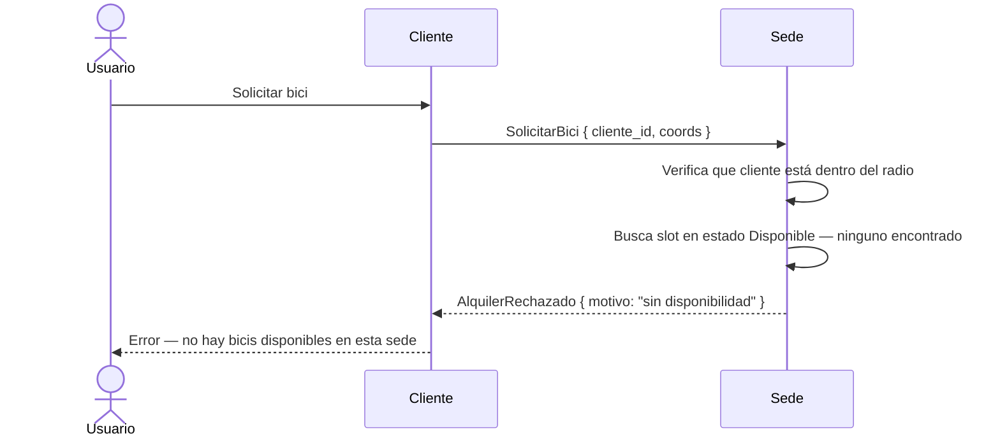
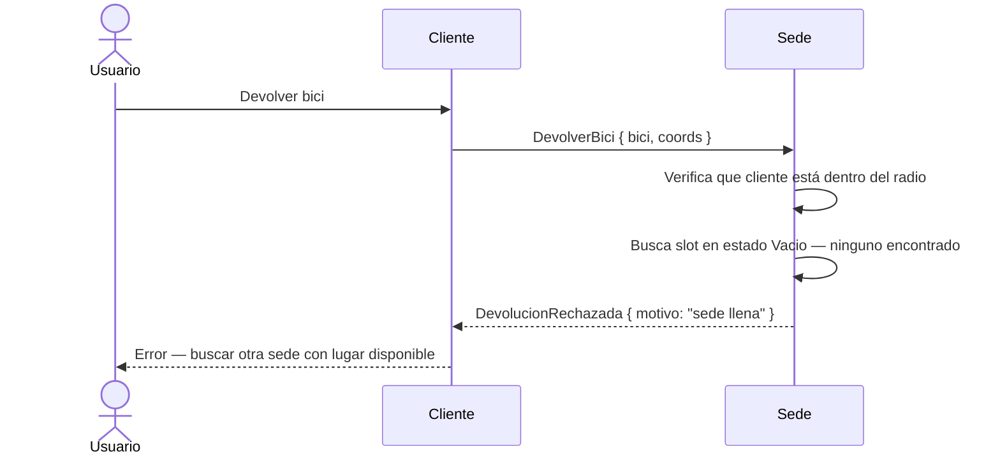
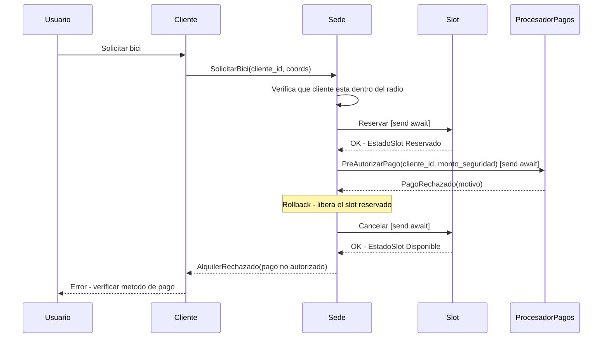
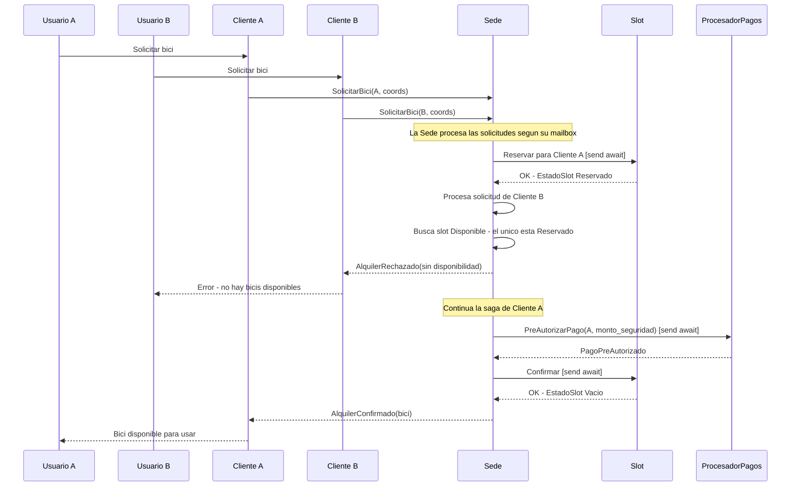
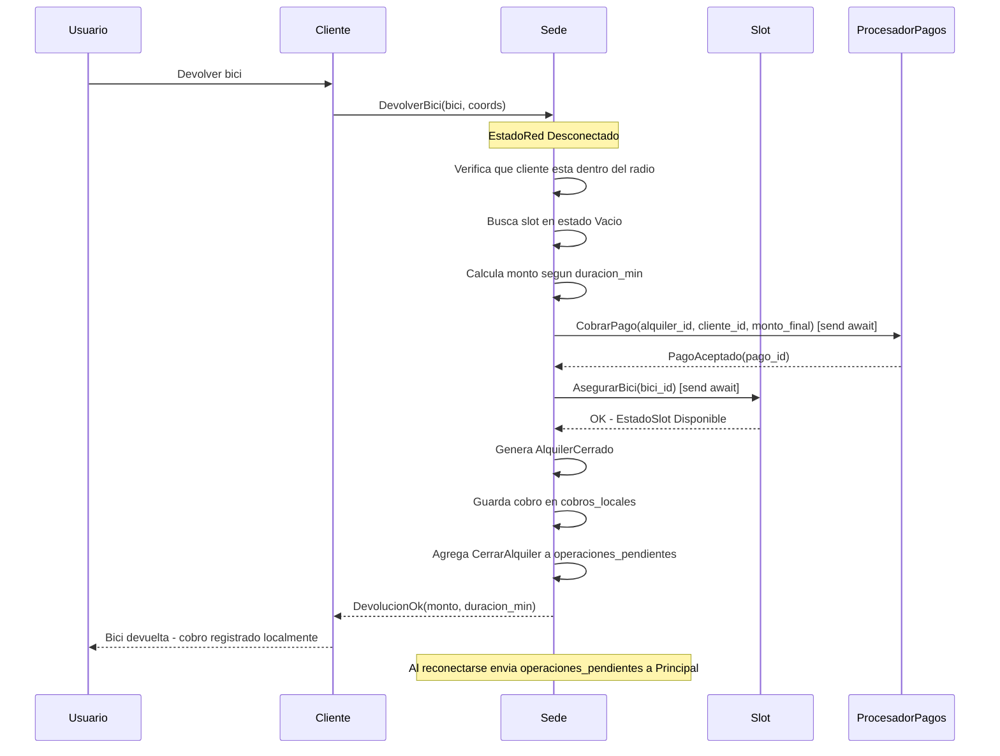
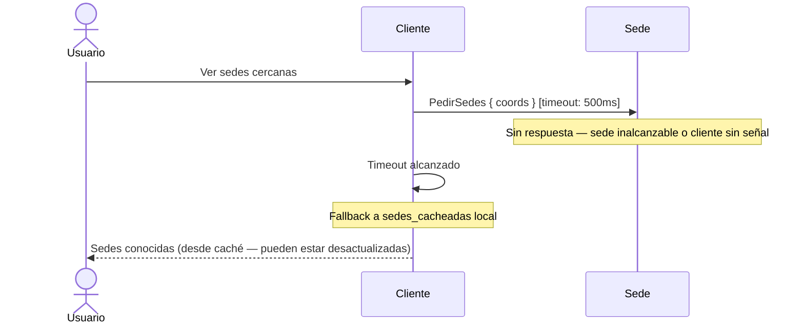
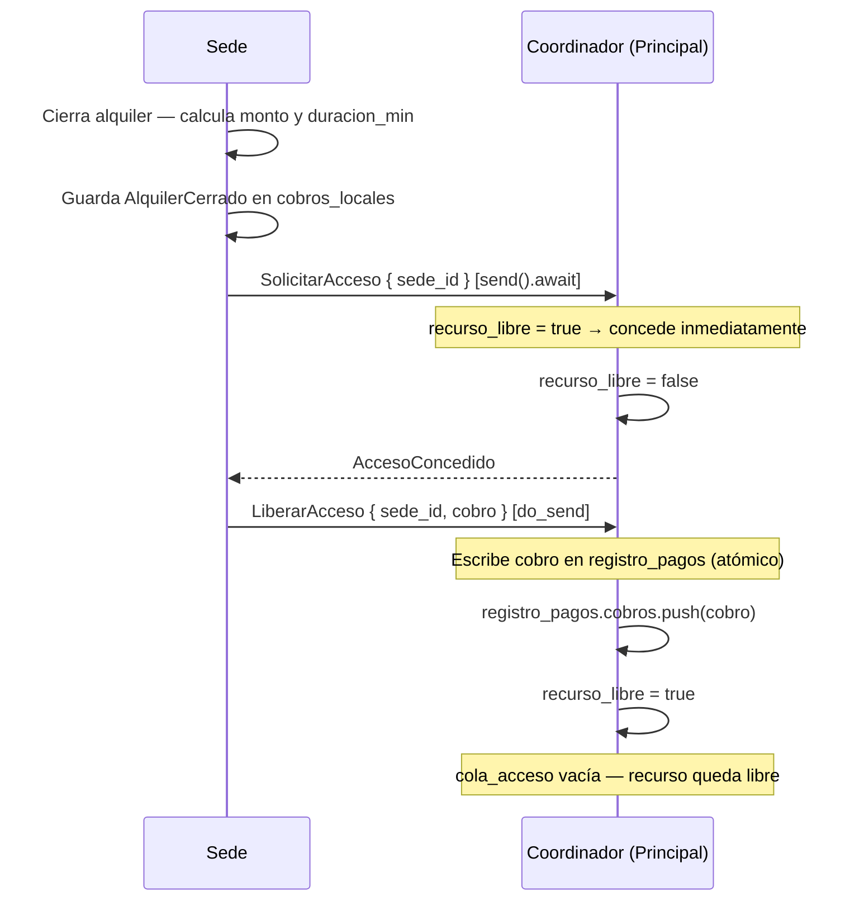
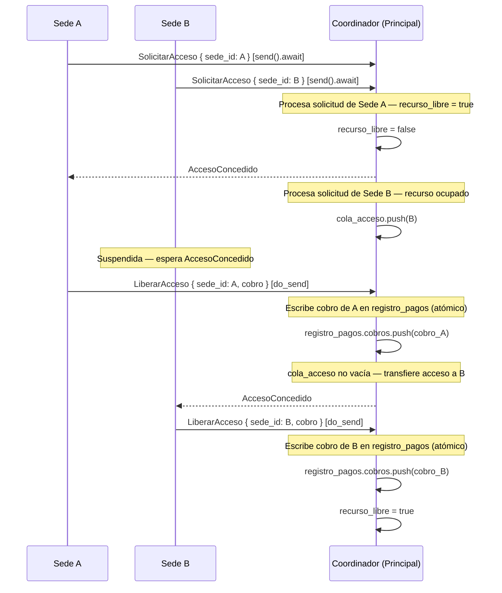

# Informe Concu — Sistema de Alquiler de Bicicletas
 
En el siguiente informe se describen las entidades, mensajes y decisiones de diseño que conforman el sistema distribuido para el alquiler y devolución automatizado de bicicletas en una ciudad. El sistema está implementado en Rust utilizando Actix como framework de actores y Tokio como runtime asincrónico.
 
Las entidades principales son:

- Bici
- Slot
- Cliente
- Sede
- ProcesadorPagos

Adicionalmente se describen los tipos de soporte que las entidades utilizan, y las decisiones de diseño transversales al sistema: operación offline, elección de líder, estrategia de heartbeat, el patrón de saga para el alquiler, el procesamiento local de pagos y el registro global de pagos con exclusión mutua distribuida.

---
 
## Modelo de Actores
 
El sistema utiliza el modelo de actores de Actix. Cada entidad con estado propio y comportamiento concurrente es un actor independiente. Los actores se comunican exclusivamente a través de mensajes, sin compartir estado mutable.
 
Existen dos mecanismos de envío de mensajes:
 
- `do_send`: Envío fire-and-forget. El emisor no espera respuesta ni confirmación. Se usa cuando el resultado del mensaje no es necesario para continuar el procesamiento actual, como por ejemplo un Heartbeat.
- `send().await`: Envío asincrónico con espera de respuesta. El emisor suspende su ejecución hasta recibir el resultado. Se usa cuando la respuesta determina el flujo siguiente, como al intentar reservar un Slot durante un alquiler.
La comunicación entre actores dentro del mismo proceso se realiza mediante `Addr<T>`. La comunicación entre procesos distintos (por ejemplo entre un Cliente y una Sede remota) se realiza mediante conexiones TCP, y cada proceso puede tener actores internos que encapsulen esa comunicación de red.
 
---
 
## Bici
 
`Bici` es una estructura de datos, no un actor. Representa a la bicicleta física y viaja como payload dentro de los mensajes del sistema. Su identificador único permite que las estaciones la reconozcan al momento de asegurarla o liberarla.
 
```rs
pub struct Bici {
    bici_id: String,
}
```
 
---
 
## Slot
 
El `Slot` es un actor que representa un espacio físico dentro de una Sede capaz de albergar una bicicleta. Cada Sede tiene entre 10 y 20 slots. Al ser un actor, su estado es gestionado de forma concurrente y segura dentro del modelo de actores.
 
```rs
pub struct Slot {
    slot_id: u32,
    estado: EstadoSlot,
    sede_addr: Addr<Sede>,
}
```
 
El campo `sede_addr` permite al Slot notificar a su Sede en caso de necesitar comunicar cambios de estado.
 
### EstadoSlot
 
```rs
pub enum EstadoSlot {
    Vacio,
    Reservado { bici_id: String },
    Disponible { bici_id: String },
}
```
 
Los tres estados describen la relación del slot con la bicicleta que alberga. Un slot `Vacio` no tiene bicicleta y puede recibir una devolución. Un slot `Disponible` tiene una bicicleta lista para ser alquilada. El estado `Reservado` es transitorio y se activa durante la saga de alquiler: el slot tiene una bicicleta pero está siendo procesada para entregarse a un cliente. Guarda el `bici_id` para poder volver al estado `Disponible` en caso de que la saga deba hacer rollback.
 
### Mensajes que recibe
 
```rs
pub enum MsgSedeASlot {
    Reservar,
    Confirmar,
    Cancelar,
    AsegurarBici { bici_id: String },
    Consultar,
}
```
 
- **Reservar**: Intenta llevar el slot del estado `Disponible` al estado `Reservado`. Si el slot no está en estado `Disponible`, rechaza la operación. Se envía con `send().await` ya que la Sede necesita saber si la reserva fue exitosa antes de continuar con la saga.
- **Confirmar**: Transiciona el slot de `Reservado` a `Vacio`, indicando que la bicicleta fue entregada al cliente y el slot quedó libre para recibir devoluciones. Se envía con `send().await` como parte de la confirmación final de la saga.
- **Cancelar**: Transiciona el slot de `Reservado` a `Disponible`, restaurando el `bici_id` que el estado `Reservado` preservaba. Es el mecanismo de rollback dentro de la saga de alquiler cuando algún paso posterior falla.
- **AsegurarBici**: Transiciona el slot de `Vacio` a `Disponible`, registrando la bicicleta devuelta por el cliente. Se envía con `send().await` durante el flujo de devolución para confirmar que el slot puede recibir la bici.
- **Consultar**: Devuelve el estado actual del slot. Se usa para que la Sede pueda construir su información de disponibilidad.
---
 
## Cliente
 
El `Cliente` es un actor que representa la aplicación móvil del usuario. Se comunica con las Sedes a través de conexiones TCP. Mantiene una caché local de sedes conocidas que le permite operar en modo offline cuando no hay conectividad.
 
```rs
pub struct Cliente {
    cliente_id: String,
    coords: (f64, f64),
    bici_activa: Option<Bici>,
    sedes_cacheadas: Vec<SedeInfo>,
}
```
 
El campo `bici_activa` almacena la bicicleta que el cliente tiene alquilada en un momento dado. El cliente es agnóstico a los detalles del alquiler: no conoce timestamps, montos ni identificadores de alquiler. Toda esa lógica vive exclusivamente en las Sedes. El cliente solo necesita saber qué bicicleta tiene para poder devolverla.
 
El campo `sedes_cacheadas` es fundamental para la operación offline. Contiene la última información conocida sobre las sedes del sistema y se actualiza cada vez que el cliente recibe una `RespuestaSedes` exitosa.
 
### Mensajes que envía
 
```rs
pub enum MsgClienteASede {
    SolicitarBici { cliente_id: String, coords: (f64, f64) },
    DevolverBici  { bici: Bici, coords: (f64, f64) },
    PedirSedes    { coords: (f64, f64) },
}
```
 
#### SolicitarBici
 
El cliente envía este mensaje a una Sede cercana cuando desea alquilar una bicicleta. La Sede valida que el cliente se encuentre dentro del radio permitido, busca un slot disponible e inicia la saga de alquiler. Si la saga es exitosa, responde con `AlquilerConfirmado`; en caso contrario, con `AlquilerRechazado`.
 
#### DevolverBici
 
El cliente envía este mensaje cuando desea devolver la bicicleta que tiene alquilada. Lo puede enviar a cualquier Sede con espacio disponible, no necesariamente a la de origen. Al recibir la devolución, la Sede calcula el monto en función del tiempo transcurrido y responde con `DevolucionOk` o `DevolucionRechazada`.
 
#### PedirSedes
 
El cliente envía este mensaje para obtener información actualizada sobre las sedes del sistema: coordenadas, disponibilidad de slots y estado de conectividad. La Sede responde con la información que conoce de sí misma y de todas las sedes vecinas registradas en su `sedes_conocidas`. El cliente no conoce a la Sede lider, por lo que para resolver esta consulta la sede con la que esté hablando el cliente delegará esta consulta a la sede lider, luego esta recolectará la información y contestará con los datos correspondientes.
 
Este mensaje implementa un mecanismo de caché con fallback: si el cliente no recibe respuesta dentro de un tiempo de espera definido, usa su `sedes_cacheadas` local como respaldo. Esto garantiza que la funcionalidad de visualización de sedes opere incluso sin conectividad.
 
### Mensajes que recibe
 
#### AlquilerConfirmado
 
Respuesta exitosa a `SolicitarBici`. Indica que la bicicleta fue asignada y el slot confirmado. La Sede envía únicamente la bicicleta asignada; el cliente la guarda en `bici_activa` y no recibe ningún detalle del alquiler, ya que esa información es responsabilidad exclusiva de la Sede.
 
```rs
AlquilerConfirmado { bici: Bici }
```
 
#### AlquilerRechazado
 
Respuesta fallida a `SolicitarBici`. Indica el motivo por el cual no fue posible realizar el alquiler, por ejemplo falta de disponibilidad o fallo en la pre-autorización de pago.
 
```rs
AlquilerRechazado { motivo: String }
```
 
#### DevolucionOk
 
Respuesta exitosa a `DevolverBici`. Incluye la duración del alquiler y el monto cobrado proporcional al tiempo de uso.
 
```rs
DevolucionOk { monto: f64, duracion_min: u64 }
```
 
#### DevolucionRechazada
 
Respuesta fallida a `DevolverBici`. Indica que la Sede no pudo recibir la bicicleta, por ejemplo porque no tiene slots vacíos.
 
```rs
DevolucionRechazada { motivo: String }
```
 
#### RespuestaSedes
 
Respuesta a `PedirSedes`. Contiene la información de todas las sedes que la Sede contactada conoce, incluyendo las propagadas mediante heartbeats de sedes vecinas.
 
```rs
RespuestaSedes { sedes: Vec<SedeInfo> }
```
 
---
 
## Sede
 
La `Sede` es el actor central del sistema. Representa una estación física con capacidad para entre 10 y 20 bicicletas. Gestiona sus slots, registra alquileres activos, mantiene información sobre sedes vecinas y opera tanto en modo conectado como desconectado.
 
```rs
pub struct Sede {
    sede_id: u32,
    coords: (f64, f64),
    slots: Vec<Addr<Slot>>,
    alquileres_activos: Vec<Alquiler>,
    cobros_locales: Vec<AlquilerCerrado>,
    estado_red: EstadoRed,
    sedes_conocidas: Vec<SedeInfo>,
    rol: RolSede,
    operaciones_pendientes: Vec<OperacionPendiente>,
    procesador_pagos: Addr<ProcesadorPagos>,
}
```
El campo `slots` contiene las direcciones de los actores `Slot`, con los cuales la Sede se comunica mediante mensajes. El campo `procesador_pagos` contiene la dirección del actor local encargado de simular la pre-autorización y el cobro de pagos dentro de la misma Sede. Al ser un actor interno al proceso de la Sede, la comunicación se realiza mediante `Addr<ProcesadorPagos>` y no requiere conectividad con el resto de las sedes.

El campo `cobros_locales` es la copia local de todos los alquileres cerrados que esta sede procesó, independientemente del estado del recurso compartido global. El campo `operaciones_pendientes` almacena las operaciones que deben sincronizarse con el resto del sistema cuando se restablezca la conectividad (ver sección de operación offline).
 
### RolSede y Elección de Líder
 
```rs
pub enum RolSede {
    Normal,
    Principal {
        alquileres_sistema: Vec<Alquiler>,
        registro_pagos: RegistroPagos,
        cola_acceso: VecDeque<u32>,
        recurso_libre: bool,
    },
}
```
 
El rol de una Sede no es estático. En tiempo de ejecución, las sedes ejecutan el algoritmo Bully de elección de líder para determinar cuál asume el rol `Principal`. La sede elegida cambia su `rol` de `Normal` a `Principal` internamente sin necesidad de reiniciarse. Esto garantiza que el sistema no tenga un único punto de falla configurado estáticamente: si la sede Principal cae, se lanza una nueva elección entre las sedes restantes.
 
La sede `Principal` cumple dos responsabilidades adicionales al resto: centraliza el registro global de alquileres activos en `alquileres_sistema` y actúa como coordinador de exclusión mutua para el `registro_pagos`. Los campos `cola_acceso` y `recurso_libre` forman el estado interno del coordinador: `cola_acceso` encola los `sede_id` que esperan acceso, y `recurso_libre` indica si el recurso está disponible para ser tomado (ver sección de Registro de Pagos).
 
### EstadoRed
 
```rs
pub enum EstadoRed {
    Conectado,
    Desconectado { desde_ts: u64 },
}
```
 
El `estado_red` determina el comportamiento de la Sede ante las solicitudes entrantes y la sincronización de datos con el resto del sistema.
 
### Operación Offline
 
Una Sede puede perder conectividad con el resto del sistema en cualquier momento. En ese caso, continúa operando localmente: puede recibir devoluciones de bicicletas y procesar alquileres con los slots que tenga disponibles, sin depender de ningún otro nodo.
 
Toda operación que normalmente sería sincronizada con la sede Principal (registrar un alquiler o cerrarlo) se encola en `operaciones_pendientes`:
 
```rs
pub enum OperacionPendiente {
    RegistrarAlquiler(Alquiler),
    CerrarAlquiler { alquiler_id: String, monto: f64, fin_ts: u64 },
}
```
`RegistrarAlquiler` representa un alquiler iniciado localmente que aún debe informarse a la Principal. `CerrarAlquiler` representa un alquiler finalizado y cobrado localmente que debe incorporarse al estado global del sistema.
 
Cuando la sede recupera la conectividad, no envia las operaciones pendientes instantaneamente sino que primero ejecuta el siguiente protocolo de reconexion:

1. Envia un `HeartbeatReconexion {sede_id, info}` a una sede vecina conocida con `send().await`, avisando que vuelve a estar online.
2. Queda esperando `RespuestaReconexion {lider_id}`, que indica quien es la sede principal actual.
3. Si `lider_id` es diferente al que tenia cuando perdio la conexion, actualiza su referencia interna.
4. Por ultimo procesa `operaciones_pendientes`

Este orden garantiza que las operaciones pendientes no se pierdan en una sede no lider. La política de resolución de conflictos ante particiones simultáneas queda como trabajo futuro.
### Mensajes que envía
 
```rs
pub enum MsgSedeACliente {
    AlquilerConfirmado { bici: Bici },
    AlquilerRechazado  { motivo: String },
    DevolucionOk       { monto: f64, duracion_min: u64 },
    DevolucionRechazada{ motivo: String },
    RespuestaSedes     { sedes: Vec<SedeInfo> },
}
```
 
```rs
pub enum MsgSedeASlot {
    Reservar,
    Confirmar,
    Cancelar,
    AsegurarBici { bici_id: String },
    Consultar,
}
```

```rs
pub enum MsgSedeAProcesadorPagos {
    PreAutorizarPago {
        cliente_id: String,
        monto_seguridad: f64,
    },
    CobrarPago {
        alquiler_id: String,
        cliente_id: String,
        monto_final: f64,
    },
}
```
 
```rs
pub enum MsgSedeASede {
    Heartbeat         { sede_id: u32, info: SedeInfo },
    HeartbeatReconexion { sede_id: u32, info: SedeInfo },
    RespuestaReconexion { lider_id: u32 },
    RegistrarAlquiler { alquiler: Alquiler },
    CerrarAlquiler    { alquiler_id: String, monto: f64, fin_ts: u64 },
    PedirActivos,
    RespuestaActivos  { alquileres: Vec<Alquiler> },
    SolicitarAcceso   { sede_id: u32 },
    AccesoConcedido,
    LiberarAcceso     { sede_id: u32, cobro: AlquilerCerrado },
}
```
 
#### Heartbeat
 
La Sede envía periódicamente un `Heartbeat` a las sedes que se encuentran dentro de un radio fijo definido por el sistema. El envío se realiza con `do_send`, ya que no requiere confirmación. El payload incluye la información actualizada de la propia sede.
 
Las sedes receptoras actualizan su `sedes_conocidas` con los datos recibidos. Cuando un cliente les solicita `PedirSedes`, responden con toda la información acumulada en `sedes_conocidas`, no solo la propia. De esta forma, la información se propaga transitivamente por el sistema sin necesidad de que cada sede haga broadcast a todos los nodos.

#### HeartbeatReconexion y RespuestaReconexion

A diferencia del `Heartbeat` periodico, el `HeartbeatReconexion` se envia con `send().await` a una sede vecina conocida, ya que la sede necesita esperar la respuesta antes de poder continuar. El receptor responde con `RespeustaReconexion { lider_id }`, informando quien es la sede `Principal` actual. Con esta informacion la sede reconectada puede actualizar su referencia interna de ser necesario y posteriormente procesar sus `operaciones_pendientes`.

#### RegistrarAlquiler y CerrarAlquiler
 
Mensajes enviados por una Sede Normal a la sede Principal para sincronizar el estado global de alquileres. Si la sede está en modo offline al momento de la operación, estos mensajes se encolan en `operaciones_pendientes` y se envían al reconectarse.
 
#### PedirActivos y RespuestaActivos
 
Utilizados durante la reconexión o la elección de líder para que una sede recupere el estado global de alquileres activos desde la Principal.
 
#### SolicitarAcceso, AccesoConcedido y LiberarAcceso
 
Mensajes del protocolo de exclusión mutua distribuida para el registro de pagos. Se encuentran dentro de `MsgSedeASede` porque el coordinador no es una entidad separada sino la sede que ejerce el rol `Principal` en un momento dado — un rol dinámico que puede cambiar ante una nueva elección de líder.
 
`SolicitarAcceso` se envía con `send().await` ya que la Sede debe suspender su ejecución hasta recibir `AccesoConcedido`. Una vez concedido el acceso, la Sede envía `LiberarAcceso` con `do_send`, transfiriendo el `AlquilerCerrado` a la Principal para que lo escriba y libere el recurso en una sola operación. Ver sección de Registro de Pagos para el flujo completo.

#### PreAutorizarPago y CobrarPago

Son mensajes enviados por la Sede a su `ProcesadorPagos` local. `PreAutorizarPago` se utiliza durante la saga de alquiler, antes de confirmar el slot y liberar la bicicleta. Si la pre-autorización falla, la Sede cancela la reserva del slot y rechaza el alquiler.

`CobrarPago` se utiliza al momento de cerrar un alquiler, luego de asegurar la bicicleta devuelta y calcular el monto proporcional al tiempo de uso. Si el cobro es aceptado, la Sede genera un `AlquilerCerrado`, lo guarda en `cobros_locales` y luego intenta sincronizarlo con el `RegistroPagos` global de la Principal.

Ambos mensajes se envían con `send().await`, ya que la respuesta del `ProcesadorPagos` determina cómo continúa el flujo.
 
### Mensajes que recibe
 
Los mensajes que la Sede recibe de los clientes son los definidos en `MsgClienteASede`. Los de otras sedes, incluyendo los del protocolo de exclusión mutua cuando la sede ejerce el rol `Principal`, son los definidos en `MsgSedeASede`. Además, la Sede recibe respuestas de su `ProcesadorPagos` local para saber si una pre-autorización o un cobro fue aceptado o rechazado.

---

## ProcesadorPagos

El `ProcesadorPagos` es un actor interno de cada Sede encargado de simular la lógica de pagos. No representa un servicio global compartido por todas las sedes, sino un componente local que permite a cada Sede pre-autorizar pagos al momento de alquilar una bicicleta y cobrar el monto final al momento de devolverla.

La decisión de modelarlo como un actor local evita introducir un único punto de falla para los pagos. Si una Sede sigue funcionando, también puede seguir comunicándose con su `ProcesadorPagos`, incluso si perdió conectividad con el resto de la red. De esta forma, la operación offline no queda bloqueada por la caída de un servicio externo centralizado.

El Cliente no se comunica directamente con el `ProcesadorPagos`. La Sede es quien tramita el pago: recibe la solicitud del Cliente, calcula cuándo corresponde pre-autorizar o cobrar, y luego delega esa operación en su actor local de pagos.

```rs
pub struct ProcesadorPagos {
    sede_id: u32,
    pagos_procesados: Vec<PagoProcesado>,
}
```

El campo `pagos_procesados` mantiene el historial local de operaciones de pago procesadas por esa Sede. Este historial no reemplaza al `RegistroPagos` global: solamente representa las operaciones que el procesador local aceptó o rechazó. El registro global de cobros cerrados sigue viviendo en la Sede Principal y se sincroniza mediante el protocolo de exclusión mutua distribuida.

### Estado de soporte

```rs
pub struct PagoProcesado {
    pago_id: String,
    alquiler_id: Option<String>,
    cliente_id: String,
    monto: f64,
    estado: EstadoPago,
}

pub enum EstadoPago {
    PreAutorizado,
    Aceptado,
    Rechazado,
}
```
`PagoProcesado` representa una operación de pago procesada localmente. En una pre-autorización todavía puede no existir un `alquiler_id` definitivo, por eso se modela como `Option<String>`. En un cobro final, en cambio, el pago queda asociado al alquiler que se está cerrando.

`EstadoPago::PreAutorizado` indica que el cliente pasó la validación previa necesaria para poder retirar una bicicleta. `EstadoPago::Aceptado` indica que el cobro final fue procesado correctamente. `EstadoPago::Rechazado` indica que la operación fue rechazada por la simulación del procesador.

### Mensajes que recibe

```rs
pub enum MsgSedeAProcesadorPagos {
    PreAutorizarPago {
        cliente_id: String,
        monto_seguridad: f64,
    },
    CobrarPago {
        alquiler_id: String,
        cliente_id: String,
        monto_final: f64,
    },
}
```

`PreAutorizarPago`: Simula la pre-autorización de un monto de seguridad antes de liberar una bicicleta. Si la operación es aceptada, responde con `PagoPreAutorizado`. Si es rechazada, responde con `PagoRechazado`.

`CobrarPago`: Simula el cobro final de un alquiler ya terminado. Recibe el `alquiler_id`, el `cliente_id` y el monto final calculado por la Sede. Si la operación es aceptada, responde con `PagoAceptado { pago_id }`. Si es rechazada, responde con `PagoRechazado`.

### Mensajes que envía

```rs
pub enum MsgProcesadorPagosASede {
    PagoPreAutorizado,
    PagoAceptado {
        pago_id: String,
    },
    PagoRechazado {
        motivo: String,
    },
}
```

`PagoPreAutorizado`: Indica que el cliente puede continuar con el proceso de alquiler.

`PagoAceptado`: Indica que el cobro final fue realizado correctamente. Incluye un `pago_id` para asociar el cobro con el `AlquilerCerrado`.

`PagoRechazado`: Indica que la operación fue rechazada. Durante el alquiler esto dispara el rollback del slot reservado. Durante la devolución, la Sede puede dejar el cobro como pendiente si la bicicleta ya fue asegurada físicamente.

### Protocolo de comunicación

La comunicación entre la Sede y su `ProcesadorPagos` se realiza dentro del mismo proceso mediante `Addr<ProcesadorPagos>`. No se utiliza TCP para esta comunicación porque ambos actores viven dentro de la misma aplicación de Sede.

Esto diferencia al `ProcesadorPagos` del `RegistroPagos`: el primero procesa localmente pagos de una Sede; el segundo es un recurso global compartido entre sedes y coordinado por la Principal.

---
 
## Saga de Alquiler
 
El proceso de alquiler involucra múltiples pasos que deben ejecutarse de forma atómica: si alguno falla, los anteriores deben compensarse para no dejar el sistema en un estado inconsistente. Este patrón se conoce como Saga.

Los pasos y sus compensaciones son:

| Paso | Acción | Compensación si falla el siguiente |
|---|---|---|
| 1 | Reservar Slot (`send().await`): `Disponible` → `Reservado` | Cancelar Slot: `Reservado` → `Disponible` |
| 2 | Pre-autorizar pago en `ProcesadorPagos` (`send().await`) | Cancelar Slot: `Reservado` → `Disponible` |
| 3 | Confirmar Slot (`send().await`): `Reservado` → `Vacio` | — (punto de no retorno) |
| 4 | Registrar Alquiler (local + Principal) | — |

Si el paso 1 falla (no hay slots en estado `Disponible`), se responde `AlquilerRechazado` directamente. Si el paso 2 falla (rechazo del pago), se envía `Cancelar` al Slot para volver al estado `Disponible`. Si el paso 3 en adelante falla, el alquiler ya fue comprometido y la compensación requeriría una operación de cierre manual.

La pre-autorización del pago no se realiza contra un servicio centralizado, sino contra el `ProcesadorPagos` local de la Sede que está ejecutando la saga. Esto permite que una Sede que sigue operativa pueda continuar alquilando bicicletas incluso si perdió conectividad con otras sedes.

Los pasos 1, 2 y 3 utilizan `send().await` porque la Sede necesita el resultado antes de avanzar. Los pasos posteriores de sincronización con la sede Principal pueden realizarse con `do_send` si la conectividad lo permite, o encolarse en `operaciones_pendientes` si no.

---
 
## Registro de Pagos
 
Cuando una Sede cierra un alquiler, primero tramita el cobro mediante su `ProcesadorPagos` local. Si el cobro es aceptado, genera un `AlquilerCerrado` y lo persiste en dos lugares: localmente en `cobros_locales` de la propia sede, y en el `RegistroPagos` compartido que vive en la sede Principal.

Es importante separar ambas responsabilidades: el `ProcesadorPagos` simula la aceptación o rechazo de una operación de pago dentro de una Sede, mientras que el `RegistroPagos` es el historial global consolidado de cobros del sistema. Este recurso compartido requiere acceso exclusivo para garantizar consistencia.
 
### Recurso compartido
 
El `RegistroPagos` es un recurso compartido entre todas las sedes del sistema. Solo una sede puede escribir en él a la vez. Para coordinar el acceso se utiliza un algoritmo de exclusión mutua distribuida centralizado, donde la sede `Principal` actúa como coordinador.
 
### Algoritmo de exclusión mutua centralizado
 
El algoritmo opera en tres fases:
 
La sede que desea registrar un cobro envía `SolicitarAcceso { sede_id }` al coordinador con `send().await`, suspendiendo su ejecución. El coordinador evalúa el estado de `recurso_libre`:
 
- Si `recurso_libre` es verdadero, marca el recurso como ocupado y responde de inmediato con `AccesoConcedido`.
- Si `recurso_libre` es falso, encola el `sede_id` en `cola_acceso` sin responder aún. La sede permanece suspendida.
Una vez que la sede recibe `AccesoConcedido`, realiza la escritura enviando `LiberarAcceso { sede_id, cobro }` con `do_send`. El coordinador, al procesar este mensaje, escribe el `AlquilerCerrado` en `registro_pagos` de forma atómica y libera el recurso. Si `cola_acceso` no está vacía, extrae el siguiente `sede_id` y le envía `AccesoConcedido`, transfiriéndole el acceso sin que el recurso quede libre entre medias.
 
### Escritura transaccional
 
El cobro se escribe en `registro_pagos` como parte del procesamiento del mensaje `LiberarAcceso` dentro del actor coordinador. Dado que los actores procesan un mensaje a la vez, esta escritura es atómica por construcción: no puede ser interrumpida ni solapada con otra escritura. Si el coordinador falla durante el procesamiento, el mensaje se descarta y la sede que esperaba nunca recibe respuesta, lo cual puede manejarse con un timeout y reintento.
 
### Copia local por sede
 
Independientemente del recurso compartido, cada sede guarda en `cobros_locales` todos los `AlquilerCerrado` que procesó. Esto permite que la sede opere y consulte su historial sin depender de la disponibilidad del coordinador, y sirve como respaldo ante una partición de red.
 
---
 
## Tipos de Soporte
 
### AlquilerCerrado
 
Representa un alquiler finalizado con todos sus datos de cobro. Es la unidad que se escribe en el `RegistroPagos` compartido y en los `cobros_locales` de cada sede.

```rs
pub struct AlquilerCerrado {
    alquiler_id: String,
    bici_id: String,
    cliente_id: String,
    sede_origen_id: u32,
    sede_destino_id: u32,
    inicio_ts: u64,
    fin_ts: u64,
    monto: f64,
    pago_id: String,
}
```
 
El campo `sede_destino_id` indica en qué sede fue devuelta la bicicleta, que puede diferir de `sede_origen_id` ya que el sistema permite devoluciones en cualquier sede.

El campo `pago_id` permite asociar el alquiler cerrado con el cobro aceptado por el `ProcesadorPagos` local de la sede que procesó la devolución.
 
### RegistroPagos
 
El recurso compartido global que vive en la sede Principal. Acumula todos los `AlquilerCerrado` del sistema. El acceso está coordinado mediante exclusión mutua distribuida.
 
```rs
pub struct RegistroPagos {
    cobros: Vec<AlquilerCerrado>,
}
```
 
### Alquiler
 
```rs
pub struct Alquiler {
    alquiler_id: String,
    bici_id: String,
    cliente_id: String,
    sede_origen_id: u32,
    inicio_ts: u64,
    pago_preautorizado: bool,
    fin_ts: Option<u64>,
    monto: Option<f64>,
}
```

`Alquiler` representa un alquiler activo o en proceso de cierre. Se crea cuando una Sede logra reservar un Slot, pre-autorizar el pago mediante su `ProcesadorPagos` local y confirmar la entrega de la bicicleta.

El campo `pago_preautorizado` indica si la validación inicial del pago fue aceptada. El cobro final no se registra en este struct, sino cuando el alquiler se cierra y se genera un `AlquilerCerrado`.
 
### SedeInfo
 
```rs
pub struct SedeInfo {
    sede_id: u32,
    addr: SocketAddr,
    coords: (f64, f64),
    slots_vacios: u8,
    slots_disponibles: u8,
    conectada: bool,
    ultimo_update_ts: u64,
}
```
 
El campo `slots_vacios` indica cuántos slots no tienen bicicleta y pueden recibir devoluciones. El campo `slots_disponibles` indica cuántos slots tienen una bicicleta lista para alquilar. Esta distinción es importante para que el cliente pueda mostrar información precisa: un usuario con bici busca `slots_vacios`, y un usuario sin bici busca `slots_disponibles`.
 
El campo `ultimo_update_ts` permite a los clientes y sedes saber qué tan reciente es la información sobre una sede, especialmente relevante cuando se opera con datos de caché.
 
El campo `conectada` refleja si la sede estaba accesible al momento del último heartbeat recibido, permitiendo al cliente mostrar este estado en la aplicación.
 
---
 
## Diagramas de Secuencia
 
A continuación se presentan los casos de uso principales del sistema, incluyendo los flujos exitosos, los rechazos esperados y los casos borde más relevantes.
 
---
 
### 1. Alquiler exitoso
 
El cliente se encuentra dentro del radio permitido, hay un slot libre y el pago es autorizado. La Sede ejecuta la saga completa sin interrupciones.
 

 
---
 
### 2. Alquiler rechazado — cliente fuera del radio
 
El cliente intenta alquilar una bici pero sus coordenadas están fuera del rango permitido por la sede. La Sede rechaza sin llegar a consultar los slots.
 

 
---
 
### 3. Alquiler rechazado — sede sin disponibilidad
 
El cliente está dentro del radio pero la sede no tiene ningún slot en estado `Disponible`. La Sede rechaza antes de iniciar la saga.
 

 
---
 
### 4. Devolución rechazada — sede sin slots vacíos
 
El cliente intenta devolver la bicicleta pero la sede no tiene ningún slot en estado `Vacio` para recibirla. El cliente debe buscar otra sede con lugar disponible.
 

 
---
 
### 5. Saga con rollback — pago rechazado
 
El slot es reservado exitosamente pero la pre-autorización del pago falla. La Sede ejecuta la compensación correspondiente: cancela la reserva del slot para dejarlo disponible nuevamente.
 

 
---
 
### 6. Dos clientes compiten por el último slot disponible
 
Este caso ilustra cómo el modelo de actores previene condiciones de carrera. La Sede procesa los mensajes de a uno, por lo que el segundo cliente recibe rechazo sin necesidad de locks explícitos.
 

 
---
 
### 7. Devolución con sede desconectada
 
La sede perdió conectividad con el resto del sistema pero sigue operando localmente. Acepta la devolución, libera el slot y encola la operación para sincronizar cuando se reconecte.
 

 
---
 
### 8. Cliente solicita sedes sin conectividad — fallback a caché
 
El cliente no tiene señal y no puede contactar ninguna sede. Usa su caché local para mostrar la última información disponible, indicando que puede estar desactualizada.
 

 
---
 
### 9. Registro de pago exitoso — sin contención
 
Una sede cierra un alquiler y registra el cobro en el recurso compartido. El coordinador concede el acceso de inmediato porque el recurso está libre.
 

 
---
 
### 10. Registro de pago con contención — dos sedes compiten
 
Dos sedes intentan registrar cobros simultáneamente. La segunda queda suspendida hasta que la primera libera el recurso. El coordinador transfiere el acceso sin que el recurso quede libre entre medias.
 

 
